# Word Rush: как сделана игра — пособие

> Живая версия с комментариями: [пособие на claude.ai](https://claude.ai/artifact/GK5vkiPnBczqKW7JgYCjp5). Здесь — копия для чтения на GitHub.

Обновлено 14 ноября 2026 · версия игры v20.4

Пособие разбирает всю разработку Word Rush по шагам: что я делал, зачем, на какие игры опиралась и как всё это поменять самой, не умея программировать. Части 1–2 объясняют, как игра устроена; часть 3 — практические рецепты правок; часть 4 — что изменилось в v18–v20.4, разбор кода и путь к релизу.

## Часть 1. Основы

## 1. Идея и образцы

**Word Rush в одной фразе:** это раннер, где английские слова стали монстрами. Чтобы победить монстра, надо вспомнить слово. А какие слова и когда показывать, решает система повторений, как в карточках для зубрёжки.

Ничего в игре не придумано с нуля. Почти у каждой механики есть образец — игра, где эта идея уже проверена миллионами игроков. Мой порядок работы всегда был такой:

1. Найти игру, где нужная тебе идея работает.
2. Понять, *почему* она там работает (что чувствует игрок).
3. Взять только эту причину и сделать её своими картинками, словами и правилами, не копируя чужой мир.

Последний пункт важен: ты просила не повторять узнаваемые локации из Adventure Time, поэтому из Time Tangle взято только ощущение (яркий мультяшный 3D-бег с боссами), а все миры нарисованы заново по твоим листам.

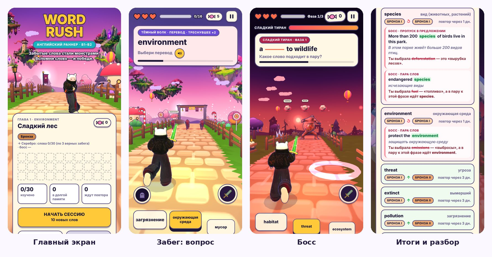

*Четыре главных экрана: дом с картой слов главы, забег с вопросом, бой с боссом, итоги с разбором ошибок.*

### Таблица образцов

| Образец | Что из него взято | Где это в Word Rush | Почему именно так |
| --- | --- | --- | --- |
| [Subway Surfers](https://en.wikipedia.org/wiki/Subway_Surfers) | 3 полосы, свайпы влево/вправо, прыжок вверх, подкат вниз, тоннели, монетки на дороге | Вся основа забега; монетки стали конфетами | Управление понятно за секунду и работает одним пальцем на телефоне |
| [Temple Run](https://en.wikipedia.org/wiki/Temple_Run) | Поворот дороги на 90° | Развилка: тоннель или длинная дорога, стена впереди | Ломает монотонность бега и заставляет принять решение |
| [Time Tangle — Adventure Time](https://toucharcade.com/games/time-tangle-adventure-time) | Твой ориентир по настроению: яркий мультяшный раннер, боссы, мини-враги | Палитры, мультяшный свет, боссы глав | Лёгкий и весёлый тон, при котором учёба не ощущается как урок |
| [The Typing of the Dead](https://en.wikipedia.org/wiki/The_Typing_of_the_Dead) | Знание слова — это оружие | Волки несут переводы; «Буквоед» — собрать слово из букв | Ошибка в слове ощущается как пропущенный удар, а не как «двойка» |
| [Система Лейтнера](https://en.wikipedia.org/wiki/Leitner_system) и [интервальные повторения](https://en.wikipedia.org/wiki/Spaced_repetition) | Коробки с карточками: знаешь — карточка уходит дальше, ошибся — назад | 6 ступеней от «Новой» до «Золота», повтор через 1, 3, 7, 14, 30 дней | Повторять слово надо прямо перед тем, как оно забудется — так учёба занимает меньше времени |
| [Duolingo](https://en.wikipedia.org/wiki/Duolingo) | Короткие сессии, задания дня, серия дней подряд, разбор ошибок в конце | Задания дня, серия с бонусом, карточки итогов | Маленькие ежедневные цели удерживают привычку |
| [Dark Souls](<https://en.wikipedia.org/wiki/Dark_Souls_(video_game)>) | Высокая сложность; после смерти твои «души» остаются на месте гибели, их можно забрать | Режим ХАРД: без лечения, волки меняются местами, конфеты остаются на дороге | Твоя просьба: «как прохождение Dark Souls». Риск потерять награду делает каждый забег напряжённым |
| [Cuphead](https://en.wikipedia.org/wiki/Cuphead) | Босс с фазами и атаками, которые видно заранее | 3 фазы босса, волны от его топота, через них надо прыгать | Игрок проигрывает из-за своей ошибки, а не из-за случайности |
| [Sekiro](https://en.wikipedia.org/wiki/Sekiro:_Shadows_Die_Twice) | Парирование: отбить удар в нужный момент | Дуэль с вампиром: свайп к верному переводу — «Parry!» | Короткая дуэль с таймером проверяет, насколько быстро ты вспоминаешь слово |
| [Quick time event](https://en.wikipedia.org/wiki/Quick_time_event) («быстро жми, чтобы вырваться») | Частые нажатия заполняют шкалу | Кот кусает героиню — тапай, пока круг не заполнится | Твоя идея: наказание за две ошибки подряд, которое игрок снимает сам |
| [The Legend of Zelda: A Link to the Past](https://en.wikipedia.org/wiki/The_Legend_of_Zelda:_A_Link_to_the_Past) | Параллельный «тёмный мир» | Мир теней: героиня становится призраком, ловушки не страшны, награда ×2 | Особая сила, которую копишь верными ответами |
| [Paper Mario](https://en.wikipedia.org/wiki/Paper_Mario), [Don't Starve](https://en.wikipedia.org/wiki/Don%27t_Starve), [Octopath Traveler](https://en.wikipedia.org/wiki/Octopath_Traveler) | Плоские рисунки в объёмном мире | Деревья, грибы, надгробия, острова — это твои рисунки на «плакатах» | Сохраняет стиль художника и почти не нагружает телефон |
| [Animal Crossing](https://en.wikipedia.org/wiki/Animal_Crossing:_New_Horizons) | Мир загибается вниз у горизонта («катящееся бревно») | Дорога уходит за изгиб | Далёкие предметы не видны, пока не нужны, — экономия и уютная картинка |
| [Guilty Gear Xrd](https://gdcvault.com/play/1022031/GuiltyGearXrd-s-Art-Style-The) | Мультяшный свет полосами и контур из «вывернутой оболочки» | Тёмно-фиолетовые контуры персонажей и декора | 3D выглядит как рисованный мультфильм |
| Карточки Человека-паука и Скуби-Ду, концепт-арты [Little Nightmares](https://en.wikipedia.org/wiki/Little_Nightmares) | Твоя идея: коллекция фактов с артами | 60 карточек-фактов, каждую охраняет деревянная реликвия | Собирательство даёт причину проходить боссов снова |
| [Audiosurf](https://en.wikipedia.org/wiki/Audiosurf) | Играть под свою музыку | «Свой трек» в настройках | Своя музыка — свой ритм бега |
| «Кто этот покемон?» из мультфильма [Pokémon](<https://en.wikipedia.org/wiki/Pok%C3%A9mon_(TV_series)>) | Сначала силуэт, потом цветная фигура | Карточки обучения: персонаж появляется из тени | Игрок запоминает врагов до первой встречи |

Дальше в каждом разделе пособия образец назван рядом с механикой, чтобы было видно, откуда она взялась.

## 2. Хронология: как росла игра

Игра выросла за неделю: с 28 октября по 2 ноября 2026. Работа шла кругами: я делал рабочую версию → ты играла на iPhone → присылала замечания и новые рисунки → я делал следующую. Такой способ называется **итеративной разработкой**: маленькие шаги, каждый можно потрогать и проверить.

| Когда | Версия | Что появилось | Зачем |
| --- | --- | --- | --- |
| 28.10 | v1 | Один файл: героиня бежит по лесу, 3 полосы, волки с переводами, 10 карточек перед забегом, босс, итоги, палитра «золотой лес → багровая арена» | Сначала проверить главное: интересно ли вообще сражаться словами |
| 28.10 | v2 | Конфеты на дороге, препятствия, усилители (магнит, щит), своя палитра для каждого этапа | Бегу нужны события между вопросами |
| 28.10 | v3–v7 | Пять версий подряд про скорость на iPhone: меньше деталей, потолок разрешения, автоматическое снижение качества при торможении | Если кадры проседают, свайпы «опаздывают» и игра кажется нечестной |
| 31.10 | v8 | Деревья, грибы и заборы из простых форм; музыка, которую игра синтезирует сама; меч и след взмаха; летучие мыши, вампир, кот | У врагов появился характер, у мира — жизнь |
| 01.11 | v9–v10 | Пыль из-под кроссовок, твой рисунок лица на модели, зелёный меч с золотой рукоятью, 8 этапов забега | Героиня стала твоей, забег — длиннее и разнообразнее |
| 01.11 | v11 | Главы, экзамены у ворот, «Мои слова», магазин, задания дня, реликвии, статистика | Появились цели на недели вперёд, а не только на один забег |
| 01.11 | v12 | Настройки «Игровые элементы», выбор мелодий, обучение, удар по вампиру, оглушение босса, Мир теней | Игрок сам решает, что ему мешает |
| 01.11 | v13 | Настоящий поворот на 90°: в тоннель или на длинную дорогу | По образцу Temple Run |
| 01.11 | v14 | Telegram Mini App: полный экран, вибрация, кнопка «Назад», сохранения в облаке Telegram | Игра попала в бота @WordRushEnglishBro\_bot |
| 01.11 | v15–v16 | Героиня танцует на титульном экране, удар с разворотом, анимированное обучение, лоу-фай | Живое меню и первое впечатление |
| 02.11 | v17 | Кот кусает за плечо; новый порядок глав; болото и зима с пингвинами; уровни глав бронза → серебро → золото; ХАРД; коллекция из 60 карточек; скины; подкат; развилка со стеной; танцующие боссы; свой трек; сложные слова 2-й главы | Большое обновление по твоему списку и архиву «дополнения» |
| 02.11 | v17.4 | Разбор ошибок с предложениями и переводом; мягкие фиолетовые контуры вместо чёрных; ровные карточки скинов; вид сзади из твоего листа; твои острова; компактное облачное сохранение | По твоим скриншотам с замечаниями |

Номера в таблице — это версии кода. У страницы игры на claude.ai своя нумерация (сейчас v22), потому что некоторые версии кода выкладывались по несколько раз.

Продолжение хронологии — версии v18–v20.4 (3–13 ноября) — в разделе 19.

### Уроки хронологии

- **Каждая версия — рабочая.** Не делай десять правок сразу: если что-то сломается, ты не узнаешь, какая из них виновата.
- **Сначала суть, потом красота.** В v1 не было ни магазина, ни музыки, но уже можно было понять, работает ли идея.
- **Телефон — главный судья.** Целых пять версий (v3–v7) ушло на скорость на iPhone: на компьютере всё было хорошо, а на телефоне нет.

## 3. Азбука веба: HTML, CSS и JavaScript

**Почему игра — это сайт.** Ты не хотела покупать Mac и платить за публикацию в App Store. Сайт открывается на любом телефоне, бесплатно хранится на GitHub и открывается прямо в Telegram. Поэтому Word Rush написан на трёх языках сайтов.

**Аналогия с театром:** HTML — это декорации и актёры на сцене, CSS — костюмы и свет, JavaScript — режиссёр, который говорит, кто и когда выходит.

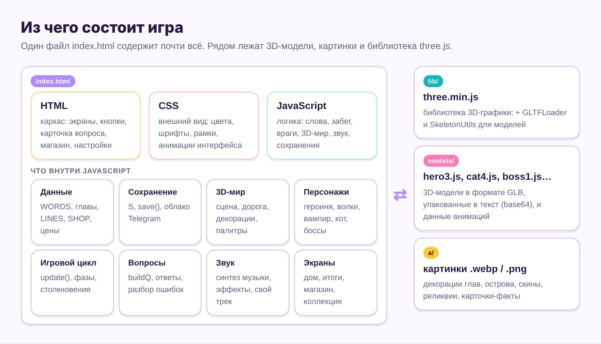

### HTML — что есть на экране

HTML состоит из **тегов** в угловых скобках. Тег открывается `<button>` и закрывается `</button>`, между ними — содержимое. Вот кнопка «Начать сессию» из игры:

```html
<button id="btnStart" class="btn"><span id="startTitle">Начать сессию</span></button>
```

- `id="btnStart"` — **имя** кнопки. По нему JavaScript её находит. Имя должно быть единственным на всю страницу.
- `class="btn"` — **стиль**. Все кнопки с классом `btn` выглядят одинаково.
- `hidden` — скрыть. В игре все экраны (магазин, настройки, итоги) лежат в файле сразу, но скрытые. Когда ты жмёшь «Магазин», код снимает `hidden` с `<section id="scrShop">`.

### CSS — как это выглядит

CSS — это правила вида «кому { свойство: значение }». В начале файла есть палитра всего интерфейса:

```css
:root{
  --ink:#1e1838; --line:#5d5084;
  --paper:#fff8e4; --sun:#ffc93a; --teal:#17b3bf;
}
```

Запись `--sun:#ffc93a` — это **переменная цвета**: жёлтый цвет кнопок записан один раз и дальше везде берётся так: `var(--sun)`. Поменяешь цвет в одном месте — он поменяется во всей игре. Именно так в v17.4 чёрные рамки стали фиолетовыми: поменялось значение `--line`.

Цвет записывается шестнадцатеричным кодом `#RRGGBB`: две цифры красного, две зелёного, две синего, от `00` до `ff`. Подобрать код можно в любой пипетке (в Figma, Photoshop или по запросу «color picker» в поиске).

### JavaScript — что происходит

JavaScript (JS) — это инструкции. В Word Rush в нём два вида вещей.

**1. Данные** — списки того, что есть в игре. Вот одно слово из первой главы:

```js
{id:'climate', en:'climate', ipa:'/ˈklaɪmət/', pos:'n', ru:'климат',
 ex:'Scientists warn that the ___ is getting warmer.', col:'climate change', not:['environment']}
```

| Поле | Что значит |
| --- | --- |
| `id` | Внутреннее имя слова, латиницей, без пробелов. По нему хранится прогресс |
| `en` / `ru` | Слово и перевод |
| `ipa` | Транскрипция |
| `pos` | Часть речи: `n` существительное, `v` глагол, `adj` прилагательное, `phr` фраза |
| `ex` | Пример с пропуском `___` — из него делается вопрос «вставь слово» |
| `col` | Устойчивое сочетание (коллокация) для вопроса «пара слов» |
| `not` | Слова, которые нельзя ставить неверными вариантами, потому что они тоже подошли бы (синонимы) |

**2. Функции** — именованные действия. Вот что происходит при нажатии на кнопку с именем `btnStart`:

```js
$('#btnStart').addEventListener('click', () => { ... });
```

Читается так: «найди на странице `#btnStart` → когда по нему кликнут → сделай то, что в фигурных скобках». Значок `$` в нашем коде — короткое имя для «найти на странице», а `#` перед именем означает «искать по id».

### Пять правил записи, которые ломают чаще всего

1. Текст в кавычках: `'климат'`. Если внутри текста нужен апостроф (`don't`), пиши `don\'t` — иначе текст «закроется» раньше времени.
2. Между элементами списка — запятая: `{...}, {...}`.
3. Скобки всегда парные: сколько `{` открыла, столько `}` закрыла.
4. Регистр важен: `btnStart` и `btnstart` — разные имена.
5. `//` — начало комментария до конца строки, `/* ... */` — комментарий на несколько строк. Игра их не читает, это заметки для людей. Заголовки разделов в нашем коде выглядят так: `/* ================= SHOP ... */`.

**Проверить себя:** открой index.html в редакторе (часть 3), найди поиском `Начать сессию`, поменяй на `В бой!`, сохрани и обнови страницу. Если надпись на кнопке сменилась — ты только что отредактировала HTML. Подвох: надпись не сменится. Поиск найдёт фразу дважды: в HTML (около строки 1077) и в JavaScript (около строки 4566), где код заново пишет текст на кнопку каждый раз, когда показывает главный экран. Поменяй оба — и запомни правило: ищи фразу по всему файлу, а не до первого совпадения.

Глубже по всем трём языкам: [MDN — Learn web development](https://developer.mozilla.org/en-US/docs/Learn), там есть курс от нуля.

## 4. Азбука three.js

**Что это.** [three.js](https://threejs.org/manual/en/creating-a-scene) — бесплатная библиотека для JavaScript, которая рисует 3D в браузере. Без неё пришлось бы самим объяснять видеокарте каждый треугольник. В игре стоит версия r128, она лежит в папке `lib/`. В коде библиотека называется коротко `T` (строка `const T = window.THREE;`), поэтому `new T.Scene()` значит «создай сцену three.js».

**Аналогия со съёмками:** сцена — съёмочная площадка, камера — оператор, рендерер — плёнка. 60 раз в секунду оператор делает кадр, а между кадрами актёры чуть-чуть сдвигаются. Так получается движение.

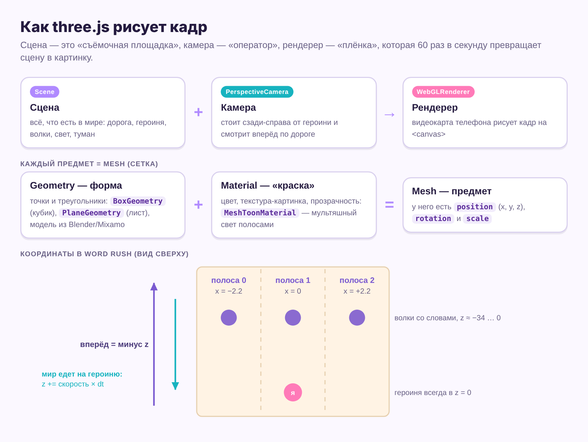

### Настоящий код из игры с расшифровкой

```js
const scene  = new T.Scene();
const camera = new T.PerspectiveCamera(60, 1, 0.1, 320);
scene.fog    = new T.Fog(0xf59fa8, 34, 118);
const sun    = new T.DirectionalLight(0xffc58a, 0.9); sun.position.set(-6, 9, 6); scene.add(sun);
```

| Что написано | Что значит |
| --- | --- |
| `PerspectiveCamera(60, 1, 0.1, 320)` | Камера с углом обзора 60°. Видит предметы от 0,1 до 320 единиц от себя; всё, что дальше, не рисуется. Число `1` — соотношение сторон экрана, игра сама подставит нужное |
| `Fog(0xf59fa8, 34, 118)` | Розовый туман: начинается в 34 единицах, в 118 предметы исчезают совсем. Туман прячет край мира и даёт глубину. У каждой палитры главы свой туман |
| `0xf59fa8` | Цвет, тот же `#f59fa8` из CSS, только в JavaScript вместо `#` пишут `0x` |
| `DirectionalLight(0xffc58a, 0.9)` | «Солнце»: тёплый свет силой 0,9, идущий из точки (−6, 9, 6), то есть слева, сверху и сзади |
| `scene.add(...)` | Положить предмет на сцену. Не добавила — не увидишь |

### Предмет = форма + материал

Любой видимый предмет — это **Mesh** (сетка). У него есть:

- **Geometry (форма)** — точки и треугольники. Простые формы three.js делает сам: куб `BoxGeometry`, шар `SphereGeometry`, конус `ConeGeometry`. Из них собраны камни, грибы, заборы и конфеты. Сложные формы (героиня, кот, боссы) приходят из файлов-моделей.
- **Material (материал)** — как поверхность отвечает на свет. В игре три главных: `MeshToonMaterial` (мультяшный свет полосами — персонажи и декор), `MeshPhongMaterial` с плоскими гранями (камни, дорога), `MeshBasicMaterial` (без света вообще — картинки-декорации, небо, контуры).
- **position, rotation, scale** — где стоит, куда повёрнут, какого размера.

### Координаты Word Rush

Положение пишется тремя числами (x, y, z). Единица условная, удобно считать её метром.

- **x — влево/вправо.** Три полосы записаны в коде так: `const LANES = [-2.2, 0, 2.2];`. Хочешь шире дорогу — увеличь 2.2.
- **y — вверх.** Земля — 0. Прыжок поднимает героиню по y.
- **z — вперёд/назад.** Героиня стоит на месте в z = 0, а весь мир едет на неё. Впереди — отрицательные числа: волки появляются далеко в минусе и подбегают к нулю.

**Почему мир едет на героиню, а не наоборот.** Так делают почти все бесконечные раннеры, включая Subway Surfers. Если бы героиня бежала вперёд, через час её координата стала бы огромной, и числа начали бы «дрожать» от неточности вычислений. А так декорации, уехавшие за спину, просто переносятся снова вперёд — как кольцо беговой дорожки.

### Модели: GLB и скелет

Персонажи хранятся в формате **GLB** — это «архив» с формой, текстурами, скелетом и анимациями в одном файле. Читает его `GLTFLoader` из папки `lib/`. В папке `models/` модели лежат не как .glb, а как .js: файл переведён в текст (base64). Так он загружается одинаково и с GitHub, и из Telegram, и с claude.ai, где дополнительные файлы скачивать нельзя. Подробнее о скелетах — в разделе 7.

**Проверить себя:** прочитай строку `M(box(1,1,1), mat('#ff7ab8'), 2.2, 0.5, -10)` вслух. Ответ: «розовый кубик размером 1×1×1 на правой полосе, чуть над землёй, в 10 метрах впереди». `M`, `box` и `mat` — наши короткие помощники из раздела THREE SETUP.

## 5. Игровой цикл

**Что это.** Игровой цикл — функция, которую браузер вызывает перед каждым кадром, обычно 60 раз в секунду. В Word Rush она называется `frame` и лежит в самом конце файла, в разделе `MAIN LOOP`. Это сердце любой игры: от Tetris до Subway Surfers все устроены так же.

**Аналогия:** рисованный мультфильм. Художник смотрит, что изменилось (ввод), двигает персонажей на чуть-чуть (обновление) и рисует новый лист (отрисовка). Только игра делает это за шестнадцатую долю секунды.

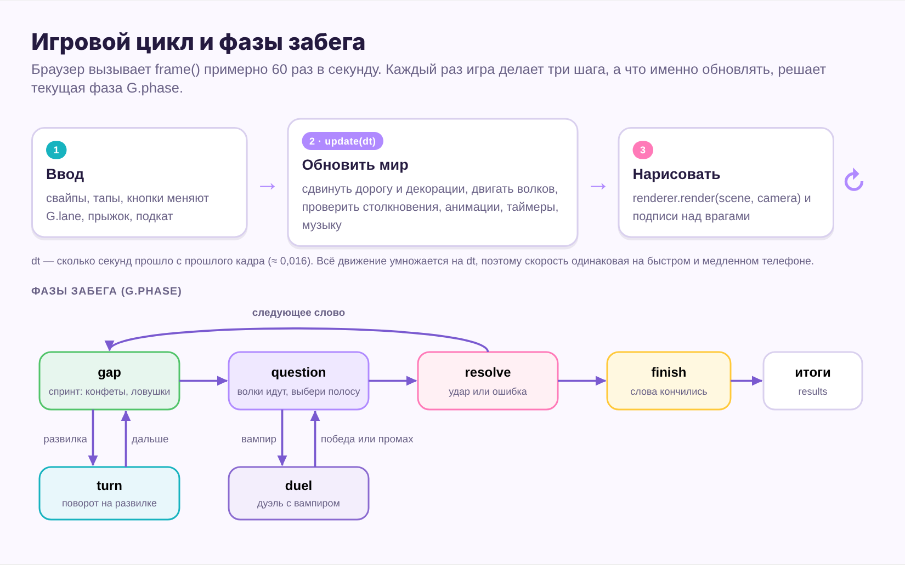

### Алгоритм одного кадра

```js
function frame(t){
  requestAnimationFrame(frame);          // 1. заказать следующий кадр
  let dt = (t - last) / 1000; last = t;  // 2. сколько секунд прошло
  if (dt > 0.05) dt = 0.05;              // 3. не больше 0,05 с
  update(dt);                            // 4. сдвинуть всё на dt
  renderer.render(scene, camera);        // 5. нарисовать
}
```

Это упрощённая версия, настоящая длиннее на пару строк. Расшифровка:

- **`dt`** (delta time, «разница времени») — сколько секунд прошло с прошлого кадра, обычно около 0,016. Любое движение считается как **скорость × dt**. Пример: скорость первого этапа 11 единиц в секунду, значит за один кадр дорога сдвигается на 11 × 0,016 ≈ 0,18 единицы.
- **Зачем умножать на dt.** Если телефон тормозит и делает 30 кадров вместо 60, dt станет вдвое больше, и дорога за секунду проедет столько же. Игра одинаково честная на любом телефоне.
- **Зачем потолок 0,05.** Когда ты сворачиваешь Telegram и возвращаешься, между кадрами может пройти минута. Без потолка волки за один кадр пробежали бы сквозь героиню.

### Фазы забега

Внутри `update` игра смотрит на переменную `G.phase` («фаза»). Это **конечный автомат**: игра всегда в одном состоянии, и для каждого состояния свои правила. Так устроены светофор и почти любой игровой персонаж.

| Фаза | Что происходит | Куда дальше |
| --- | --- | --- |
| `gap` | Спринт между вопросами: конфеты, препятствия, мыши | `question`, а на развилке — `turn` |
| `question` | Появляется карточка вопроса, волки бегут по трём полосам | `resolve`, иногда — `duel` с вампиром |
| `resolve` | Волки добежали: ты на верной полосе — удар, на неверной — минус сердце | Снова `gap` или `finish` |
| `turn` | Поворот на 90° в тоннель или на длинную дорогу | `gap` |
| `duel` | Дуэль: свайп в сторону верного перевода | Дальше по забегу |
| `finish` | Слова закончились, финишная арка | Экран итогов |

У босса свои фазы: `intro` (выход), вопросы, `stun` (босс оглушён, тапай), `dead`.

**Почему это важно для правок.** Когда ты хочешь что-то поменять «во время вопроса», ищи в коде `G.phase === 'question'`. Так находится нужное место.

### Сторож скорости

В том же цикле есть небольшой «сторож». Если кадры почти 2 секунды подряд идут медленнее нормы, игра сама снижает качество: сначала разрешение (с 1,5 до 1), потом выключает контуры декораций. Во время вопроса он ничего не трогает, чтобы не сбить тебя. А пока идёт экран загрузки, функция `prewarm` один раз рисует всех врагов и предметы за кадром. Тогда видеокарта готовится заранее, и первый волк не вызывает подтормаживания.

## Часть 2. Системы игры

## 6. Мир: дорога, горизонт, декорации, палитры

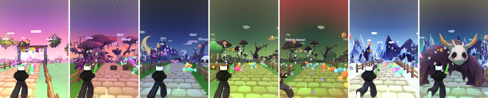

*Слева направо: глава 1 (Сахарная опушка, Сумеречный лес, Лунное кладбище), глава 2 (Грибные топи днём и в тумане), глава 3 (Ледяные пики и чудище, под которым нужно проехать подкатом).*

### Как устроен забег по мирам

У каждой главы 8 этапов. За один забег героиня пробегает их по очереди, и мир постепенно темнеет и ускоряется. В главе 1, например: Сахарная опушка → Конфетная долина → Леденцовая чаща → Сумеречный лес → Глазастая чаща → Лунное кладбище → Склеп ведьмы → Лунный мост. Скорость растёт от 11 до 15,4 единицы в секунду, ловушек становится больше.

**Сейчас (v18):** в главе 1 два места: Конфетная долина → развилка → Сумеречный лес. 8 уровней сложности остались, Лунного кладбища в главе 1 больше нет.

Описание одного этапа в коде (объект `CH_WORLD`):

```js
{name:'Сумеречный лес', sub:'Деревья открывают глаза', pal:'twilight', set:'forest',
 bio:'tw', pano:'tw', kinds:K_('rock', 'log', 'bats', 'pumpkin', 'mob', 'beast')}
```

| Поле | Что задаёт |
| --- | --- |
| `name`, `sub` | Надпись-баннер при входе в этап |
| `pal` | Палитру: небо, туман, свет, цвет травы и дороги |
| `set` | Набор объёмных декораций (заборы, фонари, грибы) |
| `bio` | Набор нарисованных декораций из твоих листов: `tw` сумеречный лес, `cem` кладбище, `sw` болото, `ice` лёд |
| `pano` | Панорама на горизонте |
| `kinds` | Какие препятствия могут появиться: `rock` камень, `log` бревно, `bats` мыши, `pumpkin` тыква, `spikes` шипы, `bounce` гриб-батут, `mob` мини-враг мира (пингвин, призрак), `beast` чудище для подката. Повтор слова делает препятствие чаще: `'rock', 'rock'` — камни вдвое чаще |

### Палитры и плавная смена

Палитра (объект `PALS`) — это набор цветов одного мира: 5 цветов неба сверху вниз, цвет и дальность тумана, свет неба и земли, солнце, трава, дорога, облака, искры. При смене этапа игра не переключает цвета резко, а смешивает старую и новую палитру в течение 1,6 секунды. Получается как закат в жизни: ты не замечаешь момента, но видишь, что стало темнее.

Почему так: в v16 ты заметила, что окружение меняется слишком быстро. В v17 у каждой главы одна тема, которая «растёт» внутри забега, а не восемь разных миров подряд.

### Изогнутый горизонт

**Образец:** Animal Crossing, где мир похож на катящееся бревно. На самом деле дорога прямая, изгиб рисует видеокарта: чем дальше точка от камеры, тем ниже она опускается.

```math
y_{\text{экран}} = y - k \cdot z^2
```

Здесь z — расстояние до камеры, k — сила изгиба, в палитрах она записана как `curve:0.0009`. Проверка: для предмета в 50 метрах сдвиг 0,0009 × 50² = 2,25 метра вниз, для предмета в 100 метрах — уже 9 метров, и он уходит за «край земли». Два плюса: новые волки «вырастают» из-за горизонта, а телефону не надо рисовать дальний мир. Учебник по такому эффекту: [World bending effect](https://notslot.com/tutorials/2020/04/world-bending-effect).

### Декорации двух видов

1. **Объёмные из простых форм** (с v8): заборы, фонари, леденцы, грибы. Каждый вид предмета склеен в одну сетку и рисуется одним пакетом (instancing): 40 заборов — одна команда видеокарте, а не сорок. Это главный приём, который сделал игру быстрой на iPhone.
2. **Рисованные «плакаты»** (с v17): твои деревья, надгробия, грибы и сугробы. До 46 штук вдоль дороги, плюс панорама на горизонте и 8 летающих островов в небе. **Образцы:** Paper Mario, Don't Starve и Octopath Traveler, где плоские рисунки стоят в объёмном мире.

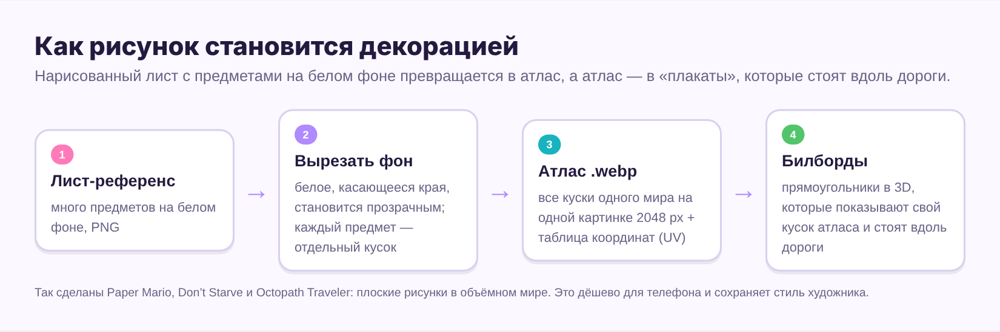

Вот как это выглядело с твоими островами в v17.4:

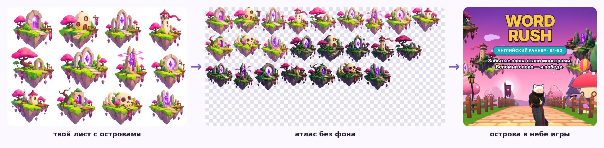

**Что такое атлас.** Вместо 25 отдельных картинок игра грузит одну большую (2048 пикселей), а рядом лежит таблица: «остров № 3 — вот этот прямоугольник». Эти координаты называются **UV**. Одна большая картинка загружается быстрее и рисуется дешевле многих маленьких.

**Плакат всегда повёрнут к камере** (строка `it.m.quaternion.copy(camera.quaternion)` в коде островов). Поэтому игрок никогда не видит, что он плоский. Такой плакат называется **билборд**.

**Что можно поменять самой:** цвета палитр (`PALS`), названия и препятствия этапов (`CH_WORLD`), силу изгиба (`curve`). Новые рисованные декорации проще прислать мне: нарезка листа на атлас делается программой на Python, вручную это долго (см. рецепты в разделе 16).

**Сейчас (v18–v18.3):** у дороги стоят 3D-модели из твоих наборов (`kit18`), рисованные плакаты — только вдали и без белой обводки.

## 7. Персонажи и анимации

### Скелет: как модель двигается

**Что это.** Внутри каждого живого персонажа есть **скелет** — набор невидимых костей (бедро, колено, плечо, кисть). Каждая точка сетки «привязана» к одной или нескольким костям. Повернулась кость — повернулась и кожа вокруг неё. Привязка называется **скиннинг**, а сама постановка скелета — **риггинг**.

**Аналогия:** перчатка на руке. Пальцы — кости, ткань — сетка. Анимация — это запись того, как двигались пальцы. Если у двух перчаток одинаковые пальцы, одну и ту же запись можно играть на обеих.

### Путь анимации от файла до игры

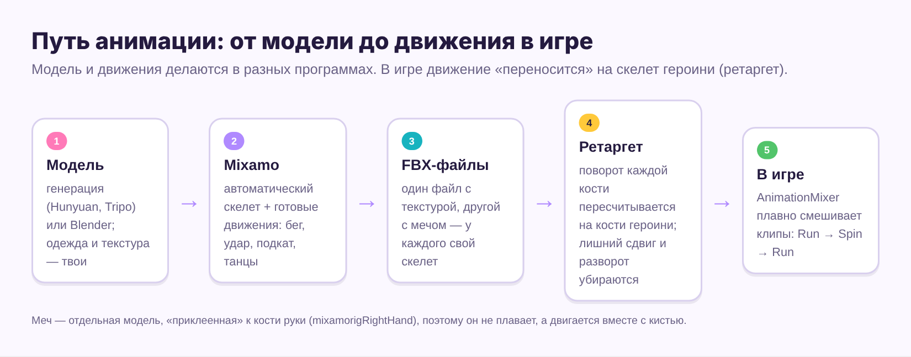

1. **Модель.** Ты генерировала героиню и врагов в нейросетях (Hunyuan 3D, Tripo) и дорабатывала в Blender. Одежда героини — твой дизайн, и в коде она нигде не меняется; меняется только расцветка в скинах.
2. **[Mixamo](https://www.mixamo.com/)** — бесплатный сервис Adobe. Загружаешь модель, ставишь точки на подбородок, запястья, локти, колени и пах, и он сам ставит скелет. Потом можно выбрать любое движение из библиотеки. Из Mixamo взяты танец героини («Hip Hop Dancing»), удар с разворотом («Sword And Shield Attack»), подкат («Running Slide») и танцы боссов. У всех скелетов Mixamo одинаковые имена костей: `mixamorigHips`, `mixamorigRightHand` и так далее.
3. **FBX** — формат, в котором Mixamo отдаёт движение. Браузер его читает плохо и файлы тяжёлые.
4. **Перенос (ретаргет).** Я записывал поворот каждой кости 30 раз в секунду, убирал сдвиг вперёд (в раннере героиня бежит на месте, помнишь? мир едет на неё) и сжимал числа. Так в коде появились строки вида `const SLIDE = {"fps":30,"n":46,"bones":["mixamorigHips", ...]}` — это подкат: 46 кадров по 30 в секунду.
5. **AnimationMixer** — «пульт аниматора» в three.js. Он плавно смешивает одно движение с другим (`crossFadeTo`), поэтому бег перетекает в подкат без рывка. В коде героини это функция `fadeHero(h, 'ИмяДвижения', времяСмешивания)`.

**Почему модели сжимались.** Игра грузится по мобильному интернету. Для каждого нового персонажа я объединял одинаковые точки сетки и уменьшал текстуры до 1024 пикселей. Например, кот сначала весил 2,5 МБ, а после сжатия — 849 КБ.

### Детали, которые делают героиню живой

- **Меч** — отдельная модель, прикреплённая к кости руки. Поэтому он не плавает в воздухе, а движется с кистью. Цвет клинка берётся из магазина (`SHOP.sword`).
- **Лицо** — твой рисунок, наложенный на модель как наклейка (декаль), которая двигается вместе с головой.
- **Пыль из-под кроссовок** и зелёный отсвет меча (точечный свет рядом с рукой).

### Мультяшный вид: свет полосами и контур

**Образец:** [Guilty Gear Xrd](https://gdcvault.com/play/1022031/GuiltyGearXrd-s-Art-Style-The). Разработчики на GDC показали, как 3D-модели выглядят нарисованными от руки. Из этих приёмов взяты два.

1. **Свет полосами (toon).** Обычный свет перетекает плавно, а у нас всего 3 ступени яркости: 59%, 84% и 100%. Они записаны в `TOON_GRAD` числами 150, 215, 255 из 255.
2. **Контур «вывернутой оболочкой».** Копия модели чуть раздувается наружу, красится в один цвет, и у неё рисуется только внутренняя сторона (`side: T.BackSide`). Из-за настоящей модели видна только тонкая каёмка — это и есть контур.

**Почему в v17.4 контур стал фиолетовым.** Ты написала, что чёрная резкая обводка «режет глаза». В хороших мультфильмах контур редко чисто-чёрный: обычно это тёмный оттенок общей палитры. Сейчас цвет контура `0x45396a` (тёмно-сиреневый), а толщина зависит от ширины экрана (строка `OUT_U.value = 1.35 / Math.max(160, w / 2)`). Чем больше число 1.35, тем толще линия.

### Скины: та же одежда, другая раскраска

**Что такое текстура.** Это картинка-«выкройка»: одежду модели как бы распороли по швам и разложили на столе. Каждый треугольник модели знает своё место на выкройке. Поэтому скин — это новая выкройка поверх той же модели.

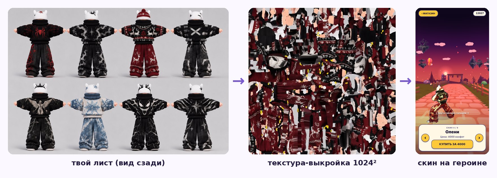

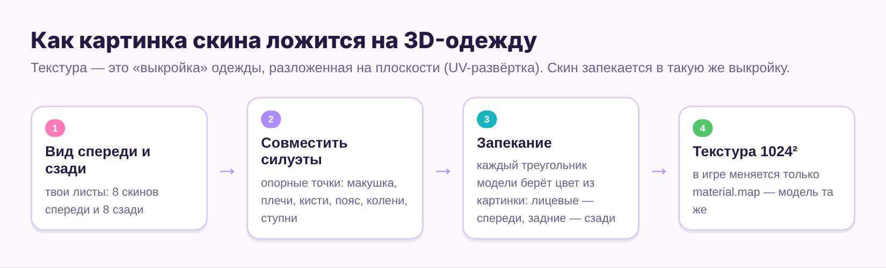

**Как делалось «запекание».** Я рисовал модель спереди и сзади, совмещал её силуэт с фигурой на твоём листе по опорным точкам (макушка, плечи, кисти, пояс, колени, ступни) и переносил цвет с листа на выкройку. Лицевые треугольники брали цвет с листа «спереди», задние — с листа «сзади», а лицо и кожа оставались родными. Именно поэтому после твоего листа с видом сзади исчезло «лицо на затылке»: раньше спина брала цвет с отзеркаленного вида спереди. В игре при смене скина меняется одна строчка — картинка в материале (`material.map`), а модель и анимации остаются прежними.

**Другие персонажи:** волки (цвет шерсти меняется по главе: поле `wolf` в `CH_WORLD`), вампир, кот, чудища для подката, два танцующих босса: Сладкий тиран (глава 1) и Болотный мул (глава 2). Все они прошли тот же путь: модель → скелет → анимации → сжатие → файл в `models/`.

## 8. Учёба внутри игры

Это главная система Word Rush. Всё остальное (волки, мечи, боссы) — упаковка для неё.

### Сессия: карточки → проверка → забег

1. **Карточки.** Перед забегом игра показывает не меньше 10 карточек: сначала новые слова (до 10), потом те, что пора повторить, потом самые слабые. Это твоя исходная идея: «сначала 10 карточек, потом слова идут в забег».
2. **Быстрая проверка** — вспомнить перевод сразу после карточек.
3. **Забег.** Новые слова плюс повторения. Чем больше новых, тем меньше повторений в одном забеге: их не больше 26 − 2 × (число новых), но не меньше 4. Так забег не растягивается.

### Интервальные повторения

**Образец:** [система Лейтнера](https://en.wikipedia.org/wiki/Leitner_system) — коробки с карточками, придуманные в 1970-х. Идея опирается на кривую забывания: свежее слово забывается за день, а каждое удачное повторение удлиняет срок памяти. Тот же принцип используют Anki и Duolingo.

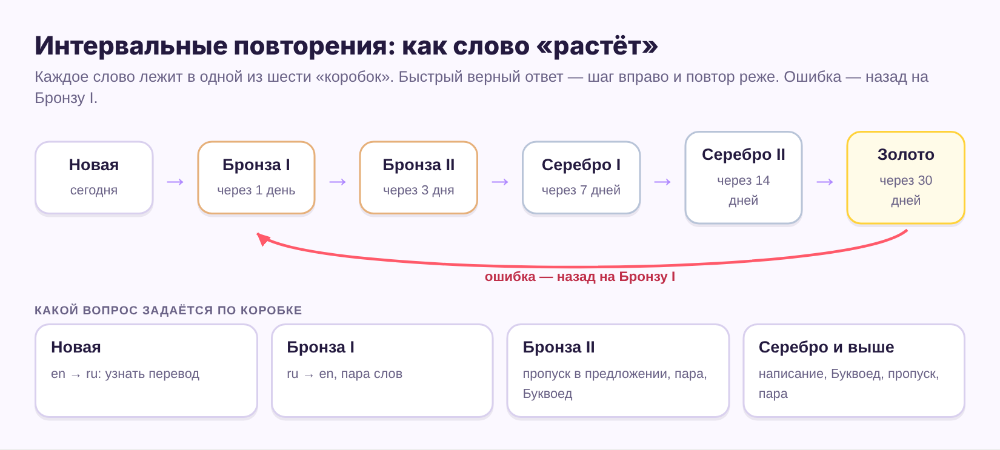

**Алгоритм после каждого забега** (функция `applyResults`):

1. Ошибся хотя бы раз в этом слове → слово возвращается на «Бронзу I» (новое остаётся новым).
2. Первый ответ был верным и **быстрым** → слово переходит в следующую коробку.
3. Верно, но медленно → слово остаётся в своей коробке.
4. Дата следующего повтора = сегодня + интервал коробки. Интервалы записаны в одной строке: `const INTERVAL_DAYS = [0,1,3,7,14,30];`

**Сейчас (v19):** слова засчитываются только за завершённый забег. Если сердца кончились или забег прерван, новые слова остаются новыми, а коробки не растут; ошибки остаются в повторении.

**Что такое «быстро».** Ответ быстрый, если ты стала на нужную полосу за 62% отведённого времени. Время на ответ зависит от типа вопроса и длины текста: от 3,8 до 8,5 секунды (функция `windowFor`). Пример: вопрос «вставь слово» с предложением и вариантами на 80 символов даёт 4,0 + 80 × 0,035 = 6,8 секунды, а «быстро» — это быстрее 4,2 секунды.

**Почему скорость важна.** Если слово вспоминается с трудом, оно ещё не выучено. В раннере это легко измерить: игра видит, когда ты сдвинулась.

### Типы вопросов и почему они усложняются

| Коробка | Какие вопросы | Что тренирует |
| --- | --- | --- |
| Новая | en → ru: выбрать перевод | Узнать слово |
| Бронза I | ru → en, «пара слов» (коллокация) | Вспомнить английское слово |
| Бронза II | вставить слово в предложение, пара слов, «Буквоед» | Понять контекст |
| Серебро I | написание, «Буквоед», пропуск | Правописание |
| Серебро II, Золото | все сложные типы вперемешку | Прочное знание |

Таблица живёт в функции `qTypeFor2`. Переход от «узнать» к «вспомнить» и «написать» — классический путь запоминания: узнавать слово всегда легче, чем доставать его из памяти. Неверные варианты берутся из той же главы, но синонимы из поля `not` никогда не попадают в список, чтобы не было двух верных ответов.

**Сейчас (v18.2–v19):** обычный вопрос — «угадать перевод» (en→ru или ru→en). Сложный тип выпадает с шансом 15%, с Серебра I — 22%, в туннеле — 40%. Предложения и пары слов в забегах глав выключены; их включает переключатель «Предложения в забеге», отдельно для каждой главы. У босса они остались.

### Разбор ошибок

**Образец:** экран ошибок в конце урока Duolingo. В v17.4 по твоей просьбе каждая ошибка забега, босса и дуэли записывается (функция `misLog`) и показывается на карточке слова в итогах: где была ошибка (забег, босс, дуэль), предложение целиком с верным словом, перевод предложения и то, что ты выбрала вместо него. Переводы 286 предложений и словосочетаний лежат в объекте `TR_RU`. Пример такой карточки — на четвёртом скриншоте в разделе 1.

**Почему целое предложение, а не слово.** Перевод одного слова быстро забывается, а фраза показывает, как слово живёт в речи, и объясняет, почему похожее слово не подошло.

### Прокачка глав: бронза → серебро → золото

- **Как подняться:** все слова текущего уровня угаданы верно в 3 разных забегах **и** босс главы побеждён на этом уровне.
- **Что даёт новый уровень:** 16 новых слов посложнее, скорость бега +12%, время на ответ −10%, босс сильнее.
- **Как упасть:** 3 проигранных забега подряд — и глава опускается на уровень ниже. После второго проигрыша игра предупреждает. Выученные слова остаются выученными, а босса придётся победить снова.

Это твоё правило: «если игрок долго не справляется, его сбрасывает на бронзу». Образец — ранги в соревновательных играх, где ранг можно потерять: он показывает текущий уровень игрока, а не достижение навсегда. Настройки лежат в разделе кода `v17 CHAPTER LEVELS`: числа `0.12` (ускорение), `0.1` (меньше времени), `>= 3` (сколько верных забегов нужно).

## 9. Механики и враги

Каждая механика отвечает на один вопрос: **что игрок должен почувствовать?** Правило, которого я держался: каждый враг связан со словами (заставляет вспоминать, наказывает за ошибки или награждает за серию верных ответов) или даёт передышку между вопросами.

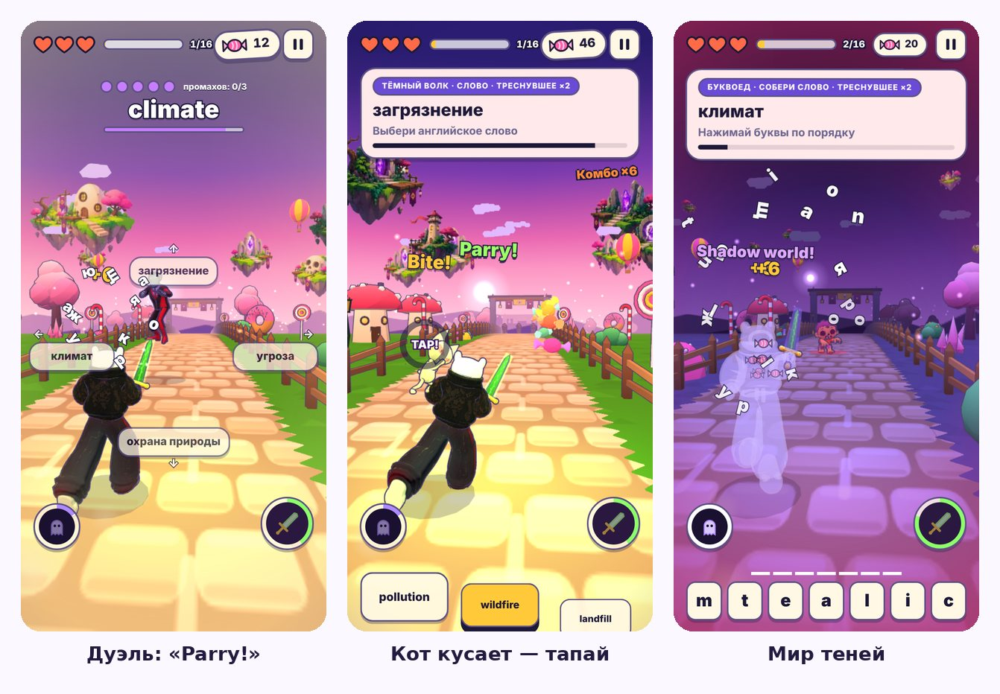

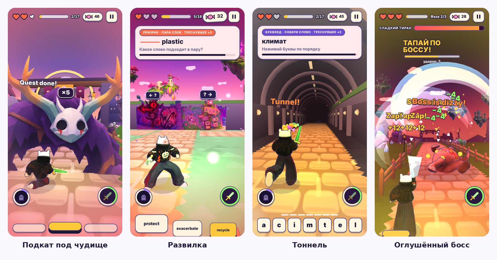

| Механика | Как работает | Образец | Что чувствует игрок |
| --- | --- | --- | --- |
| Волки со словами | Три волка несут три варианта. Встань на полосу с верным, пока они не добежали. Ошибка — минус одно из 3 сердец | The Typing of the Dead, Subway Surfers | Вспомнить слово = спастись |
| Меч и удар с разворотом | Быстрые верные ответы заряжают меч. Полный заряд — кнопка меча сносит всё впереди | «Ульта» из экшен-игр | Награда за беглое знание |
| Летучие мыши | Одну надо тапнуть несколько раз, стаю — рассечь свайпом | Fruit Ninja (рассечь свайпом) | Передышка руками между вопросами |
| Вампир | Лежит на склепе у дороги, потом встаёт вместо волка. Если верное слово у него — встань на его полосу и свайпни вниз | Мини-боссы, которые «следят» за игроком | Тревожное ожидание |
| Дуэль с вампиром | Слово в центре, 4 перевода по 4 сторонам. Свайп к верному — «Parry!». У вампира 5 жизней, тебе разрешено 3 промаха, на раунд 3,6 с. Победа — +40 конфет и 8% шанс реликвии | Sekiro (парирование) | Скорость памяти под давлением |
| Кот | Две ошибки подряд — кот прыгает на плечо и кусает. Героиню мотает по полосам. Быстро тапай по коту: круг заполняется за 14 тапов (в ХАРДе за 20) и пустеет, если сделать паузу. Ещё кот прячет ответы и бросает клубки | Quick time event «долби, чтобы вырваться» | Ошибки подряд ощутимы, но поправимы |
| Подкат | Рогатое чудище стоит аркой над дорогой. Пройти можно только свайпом вниз | Subway Surfers (кувырок под барьером) | Третий жест кроме «влево-вправо» и «прыжок» |
| Развилка | Дорога уходит влево и вправо. За одним поворотом тоннель с ловушками и двойными конфетами, за другим — длинная спокойная дорога. Где что — загадка | Temple Run | Риск или отдых — выбираешь сама |
| Мир теней | Верные ответы заряжают призрака. Заряжен — проведи двумя пальцами вниз: героиня становится призраком, ловушки не страшны, ответы видны в последний момент, награда ×2 | Тёмный мир в Zelda: A Link to the Past | Риск ради двойной награды |
| Мини-враги мира | Пингвины катятся на животах, призраки плывут, грибы прыгают через тропу | Тематические враги уровней в платформерах | Мир живой и свой у каждой главы |
| Усилители | Магнит (конфеты летят сами), щит (спасает от одного столкновения с препятствием или стаей мышей) | Subway Surfers | Маленькие подарки по дороге |

**Сейчас (v18–v20):** кнопки меча нет — справа щит-спасатель: заряжается медленно и спасает последнее сердце. Мир теней включается тапом по призраку слева внизу и слова не прячет. Слова несут только волки. Прыжок через препятствие засчитывается всегда, шлагбаум можно перепрыгнуть. Удар о препятствие — минус 30% конфет забега, не меньше 12. Вампир и дуэль есть в каждой главе.

### Боссы

**Образец:** [Cuphead](https://en.wikipedia.org/wiki/Cuphead) — босс с несколькими фазами и атаками, которые видно заранее.

1. Босс открывается, когда изучены все слова главы.
2. У него 14 единиц здоровья и 3 фазы: вторая начинается, когда здоровья меньше 64%, третья — когда меньше 30%.
3. В большей части боя боссы танцуют (твоя идея) и топают, от топота идут волны — их надо перепрыгивать.
4. Серия из 4 верных ответов подряд — босс падает оглушённым, и ты тапаешь по нему, нанося урон.
5. Победа всегда даёт реликвию (раздел 10).

### Режим ХАРД

**Образец:** [Dark Souls](<https://en.wikipedia.org/wiki/Dark_Souls_(video_game)>). Ты просила, чтобы ХАРД был «очень сложным, как прохождение Dark Souls». Из Dark Souls взяты три идеи:

- **Без лечения:** запасное сердце не срабатывает, каждая ошибка ещё и ускоряет бег на 3,5% (до +25%).
- **Враги хитрят:** с вероятностью 55% два волка меняются полосами посередине вопроса («Swap!»). Дуэль и босс строже.
- **Мешок конфет:** если героиня падает, собранные конфеты остаются лежать на дороге. В следующем забеге этой же главы мешок появится примерно в том же месте забега. Подбери его, иначе пробежишь мимо и потеряешь конфеты навсегда («Lost forever…»). В Dark Souls так лежат потерянные души.

Награда за ХАРД — скин «Тёмный ангел», его нельзя купить.

## 10. Экономика и мотивация

**Зачем экономика в учебной игре.** Интервальные повторения работают, только если ты возвращаешься каждый день. Конфеты, магазин и коллекция дают короткие цели («куплю огненный меч») и длинные («соберу все 60 карточек»), пока слова учатся мимоходом.

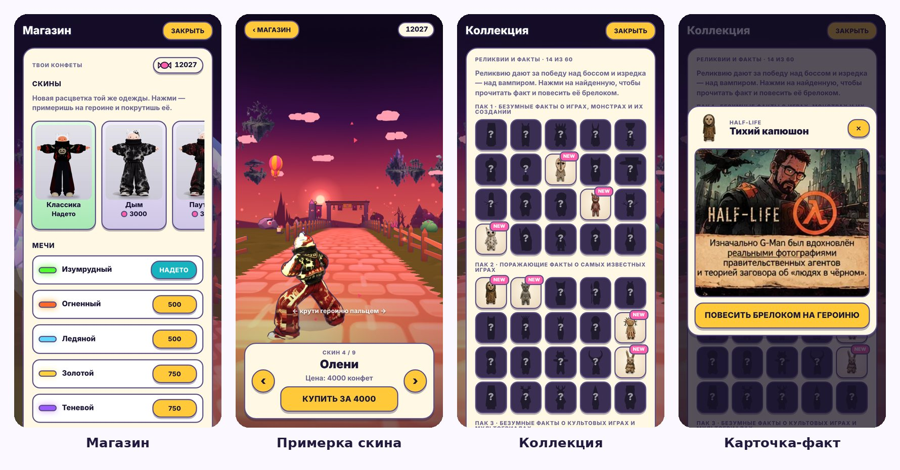

### Откуда берутся конфеты

| Источник | Сколько |
| --- | --- |
| Конфета на дороге | 1; ×2 с усилителем ×2, ×2 в тоннеле, ×2 в ХАРДе |
| Подкат под чудищем, удар мечом | 2 |
| Удар по вампиру на дороге | 20 |
| Победа в дуэли, сундук | 40 |
| Задание дня | 40–100 |
| Победа над боссом | 100 |
| Экзамен у ворот главы | 100 |
| Серия дней подряд | 20 × длина серии, но не больше 200 |

**Сейчас:** удара мечом нет (вместо меча — щит), сундука тоже: таинственная арка даёт +40 конфет вспышкой.

### На что тратить

| Товар | Цена | Зачем такая |
| --- | --- | --- |
| След взмаха | 200–250 | Дешёвая первая покупка: игрок быстро узнаёт, что магазин есть |
| Запасное сердце | 150 | Дёшевая страховка |
| Мечи | 500–1500 | Заметная цель на неделю |
| Улучшения (магнит, щит, меч, тень) | 300 → 650–750 → 1100–1200 | Каждая ступень дороже предыдущей |
| Скины одежды | 3000–8000 | Долгая цель на недели |
| «Тёмный ангел» | не продаётся | Только за победу над боссом в ХАРДе |

**Образцы:** наряды персонажей в Subway Surfers и магазин обликов в Fortnite. В них покупки не дают преимущества в бою, только внешний вид. Поэтому у нас скины только меняют вид, а усиливают только дешёвые улучшения: деньгами нельзя «купить» знание слов.

**Примерка.** Перед покупкой скин можно покрутить на 3D-героине пальцем. Люди чаще покупают то, что увидели на себе, и реже разочаровываются.

**Сейчас (v20):** в магазине ещё 8 скинов, от 3000 до 9000 конфет. «Всеведущий» не продаётся: его дают за победу над любым боссом.

### Коллекция: 60 карточек-фактов

Идея твоя: собирать не просто реликвии, а факты с артами, как коллекционные карточки с Человеком-пауком или Скуби-Ду. Устройство:

- 60 карточек в 3 наборах: «Безумные факты о играх, монстрах и их создании», «Поражающие факты о самых известных играх», «Безумные факты о культовых играх и мультсериалах». Картинки — твои готовые карточки из архива, файлы `a/cards/c00…c59.webp`.
- Каждую карточку «охраняет» деревянная реликвия. Нашла реликвию — открыла факт.
- Реликвия даётся всегда за победу над боссом, с шансом 8% — за победу в дуэли и 4% — за удар по вампиру на дороге. Редкость делает находку ценной.
- Реликвию можно повесить брелоком на пояс героини.
- Когда всё собрано, вместо реликвии дают 150 конфет.

**Сейчас (v20.2–v20.4):** открытая карточка лежит в глянцевой плёнке, картинки в 3 раза чётче. Брелок висит сбоку на поясе, застёжка у каждой реликвии своя (раздел 19).

### Задания дня и серия

**Образец:** задания дня и серия (streak) в Duolingo. Каждый день игра выбирает несколько заданий из списка `QUEST_POOL`: «Ответь верно 12 раз», «Дойди до уровня 5», «Прогони 3 стаи мышей». Задания специально про разные механики: они подталкивают попробовать то, чем ты ещё не пользуешься (Мир теней, меч).

## 11. Звук и музыка

**Главное решение: музыка не записана, а синтезируется.** В игре нет ни одного mp3. Все мелодии и звуки собираются из нот прямо в браузере с помощью [Web Audio API](https://developer.mozilla.org/en-US/docs/Web/API/Web_Audio_API) — встроенного в браузер синтезатора.

Почему так:

- **Размер.** Одна песня в mp3 весит 3–5 МБ, а её ноты в коде — несколько строчек.
- **Музыка растёт вместе с забегом.** Каждая мелодия состоит из 4 слоёв (барабаны, бас, аккорды, мелодия). На первом этапе звучат два, дальше добавляются остальные (таблица `LAYER_MIX`). Так делают многие игры: напряжение в музыке растёт одновременно со сложностью.
- **Авторские права.** Чужую песню нельзя встроить в игру без лицензии. Поэтому, когда ты просила трек в духе FUNK ECLIPSE, появился оригинальный «Дрифт-фонк» (130 ударов в минуту): похожий стиль, свои ноты.

### Как нота становится звуком

Ноты записаны номерами MIDI: 60 — до первой октавы, 69 — ля, каждая единица — полутон. Из номера в частоту нота переводится формулой (в коде функция `mhz`):

```math
f = 440 \cdot 2^{(m - 69)/12}\ \text{Гц}
```

Проверка: m = 69 даёт 440 Гц (эталонное «ля»), m = 81 — на октаву выше, 880 Гц. Мелодия записана тройками `[начало, длина, нота]`, например `[0,4,74]` — «с первой доли, 4 шага, ре второй октавы». Инструмент — это генератор волны (синус, пила, квадрат) плюс фильтр и громкость, которая быстро нарастает и затухает. Вся песня один раз рендерится в фоне (`OfflineAudioContext`) и потом играет по кругу, поэтому телефон не тратит силы на музыку во время игры.

### Мелодии в настройках

| Мелодия | Стиль | Темп, ударов в минуту |
| --- | --- | --- |
| Лоу-фай (главная) | тёплый | 76 |
| Дрифт-фонк | фонк | 130 |
| Конфетный рывок | поп | 124 |
| Ночная погоня | синтвейв | 108 |
| 8-бит приключение | чиптюн | 140 |
| Лоу-фай прогулка | спокойная | 82 |
| Драйв | рок | 150 |
| Свой трек | любой файл с телефона | — |

### Свой трек

**Образец:** [Audiosurf](https://en.wikipedia.org/wiki/Audiosurf), где трасса строится под твою музыку. У нас проще: в настройках можно загрузить mp3 или m4a, и он заиграет во время забега.

- Файл хранится только в памяти браузера на телефоне (IndexedDB) и никуда не отправляется.
- В тоннеле, на дуэли и с боссом трек становится глухим (фильтр оставляет частоты ниже 820 Гц, как будто музыка за стеной), и поверх него идёт стук сердца. Так даже с чужой музыкой игра показывает напряжённый момент.
- На экране блокировки iPhone видна обложка с вампиром: игра передаёт системе название и картинку `icon-512.png` (Media Session).

**Сейчас (v18):** свой трек больше не глушится в туннеле и на дуэли. Новый трек — «Тёплая гитара».

**Звуковые эффекты** (удар, конфета, мяу, смех вампира) тоже синтезируются: их ищи в коде по слову `sfx.` (например, `sfx.meow2()`).

## 12. Интерфейс и обучение

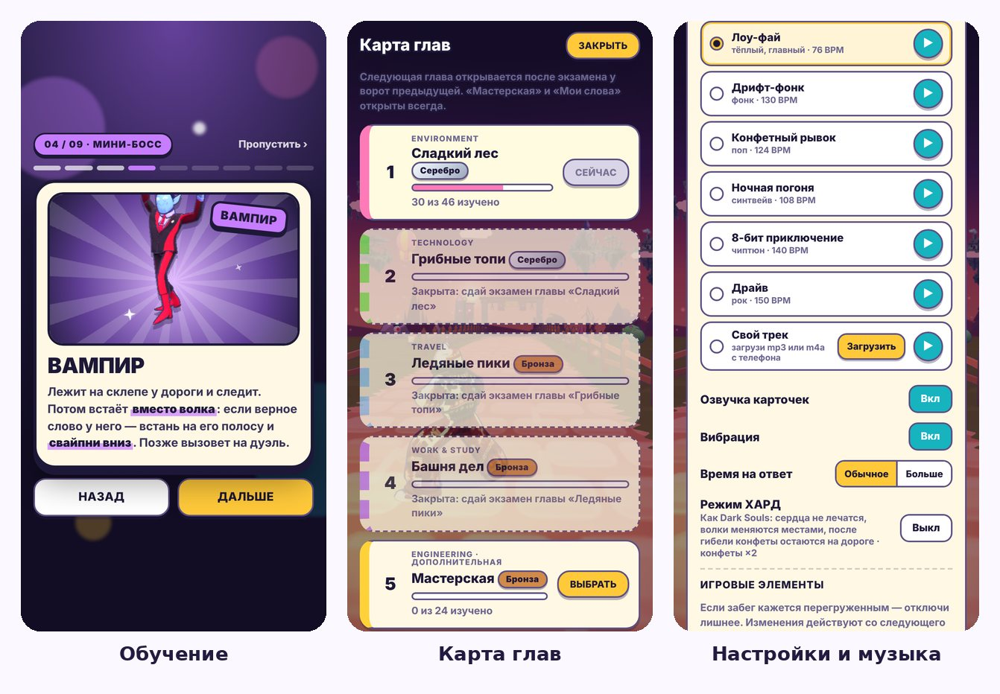

### Правила, по которым строился экран

1. **Телефон в одной руке.** Кнопки ответов внизу, под большим пальцем. Вверху только то, что нужно читать: сердца, прогресс, карточка вопроса.
2. **Вырез и «чёлка» iPhone.** Отступы считаются через `safe-area-inset`, поэтому ничего не прячется под вырез камеры и полоску «домой».
3. **Подсказки короткие и на английском.** В v16 они перекрывали варианты ответов — ты это заметила. В v17 они стоят под карточкой вопроса и звучат так: «Spell it! Tap the letters». Это ещё и крошечная практика английского.
4. **Реплики врагов.** Вампир, кот и боссы говорят короткие фразы по-английски в пузырях («Mine now!», «Gotcha!»). Все реплики лежат в объекте `LINES`, их легко поменять.
5. **Шрифты.** Заголовки — Unbounded (толстый и игривый), текст — Nunito (округлый и легко читается). Оба бесплатные, из Google Fonts, оба с кириллицей.
6. **Вибрация.** Каждое событие (смена полосы, ошибка, босс) имеет свой тип вибрации. В Telegram она идёт через сам Telegram — так вибрация работает и на iPhone, где обычный сайт вибрировать не умеет.
7. **Уважение к настройкам телефона.** Если в iPhone включено «Уменьшение движения», игра отключает лишние анимации интерфейса (`prefers-reduced-motion` в CSS).

**Сейчас (v19.2):** интерфейс «конфетный винил»: глянцевые кнопки с отдачей, разделы на главной — пластинки вокруг героини, настройки — шестерёнка вверху.

### Обучение: 9 карточек

Правила, Управление, Героиня, Мини-босс, Хулиган (кот), Поворот, Сила (Мир теней), Босс, Настройки. Тексты лежат в списке `TUT2`.

**Образец:** «Кто этот покемон?» из мультсериала [Pokémon](<https://en.wikipedia.org/wiki/Pok%C3%A9mon_(TV_series)>). Персонаж сначала показан чёрным силуэтом с вопросительным знаком и лучами, потом проявляется в цвете. Картинки персонажей игра фотографирует сама из своих же 3D-моделей при загрузке. Поэтому силуэт всегда совпадает с тем, кого ты встретишь.

**Почему карточки, а не длинный текст.** На одной карточке одна идея и одна картинка. Ключевое действие выделено жирным («**встань на полосу с верным**»), и карточку можно пролистать за пару секунд. Обучение можно пройти снова из настроек.

### Настройки

- **Игровые элементы** — выключатели кота, мышей, Мира теней, подсказок и так далее. Идея: игрок сам убирает то, что ему мешает учиться.
- **Время на ответ** — «Обычное» или «Больше». Это множитель `S.pace`, на который умножается окно из раздела 8.
- **Озвучка карточек** — браузер читает слово встроенным голосом телефона (игра ищет британский английский голос), файлы звука не нужны.
- **Режим ХАРД**, мелодии, свой трек, перенос сохранения файлом или кодом.

**Сейчас (v18):** слова озвучивает записанный голос героини (mp3 на каждое слово). Встроенный голос телефона читает только твои слова, для которых записи нет.

## 13. Путь к игроку: GitHub, Telegram, сохранения

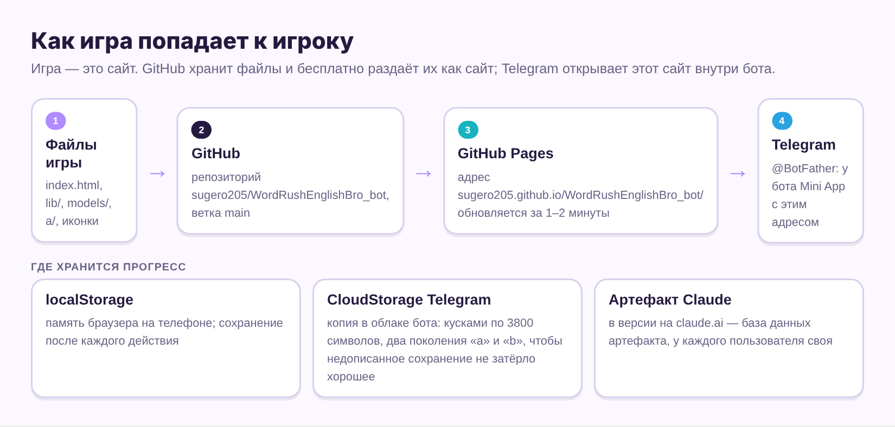

### Доставка в три шага

1. **GitHub** хранит файлы игры в твоём репозитории `sugero205/WordRushEnglishBro_bot` и помнит всю историю изменений. Каждое сохранение версии называется **коммит**. Если что-то сломалось, любой прошлый коммит можно открыть и вернуть.
2. **GitHub Pages** бесплатно превращает репозиторий в сайт `https://sugero205.github.io/WordRushEnglishBro_bot/`. Настройка делается один раз: Settings → Pages → Source: Deploy from a branch → ветка `main`, папка `/ (root)` → Save ([инструкция GitHub](https://docs.github.com/en/pages/getting-started-with-github-pages/configuring-a-publishing-source-for-your-github-pages-site)). После этого каждый коммит в `main` сам попадает на сайт; обычно это занимает 1–2 минуты.
3. **Telegram** открывает этот сайт внутри бота как [Mini App](https://core.telegram.org/bots/webapps). Кнопка «Играть» настраивается у @BotFather: Bot Settings → Menu Button → ссылка на игру. Пошагово всё расписано в README.md в репозитории.

**Главное следствие:** чтобы обновить игру у всех, достаточно заменить файлы на GitHub. Бота трогать не нужно.

### Что игра делает именно в Telegram

В начале файла подключается скрипт `telegram-web-app.js`. Раздел кода `v14 TELEGRAM MINI APP` с его помощью разворачивает игру на всю высоту, запрещает сворачивать её свайпом вниз (иначе подкат закрывал бы игру), включает вибрацию и кнопку «Назад» и спрашивает подтверждение, если закрыть бота посреди забега.

### Где живёт прогресс

Весь прогресс — это один объект `S` (конфеты, коробки слов, покупки, настройки). Функция `save()` превращает его в текст (JSON) и кладёт:

- **в память браузера** (`localStorage`, ключ `wordrush-forest-v1`) — всегда;
- **в облако Telegram** (CloudStorage) — когда игра открыта в боте. Тогда прогресс одинаковый на телефоне и на компьютере.

**Почему облако сделано так хитро.** Telegram принимает не больше 4096 символов на одну запись и до 1024 записей на игрока ([документация CloudStorage](https://core.telegram.org/bots/webapps)). Поэтому:

1. Сохранение режется на куски по 3800 символов, с запасом до лимита.
2. Сохранений два, «а» и «б», они пишутся по очереди. Запись «какое сохранение свежее» делается последней. Если ты закроешь Telegram посреди записи, старое целое сохранение не пострадает.
3. В v17.4 сохранение стало компактным: нетронутые слова в него не пишутся. Было 6 кусков и ошибки по времени, стал 1 кусок около 1,1 КБ.

Версия игры на claude.ai хранит прогресс отдельно, в своей базе данных артефакта. Перенести прогресс между версиями можно в настройках: скачать файл сохранения или скопировать код.

**Сейчас (v18.4):** есть бета по адресу `…/beta/` со своим сохранением и без облака Telegram (раздел 20).

### Иконки и «старая картинка»

Телефоны запоминают скачанные файлы (кэш), чтобы не грузить их заново. Из-за этого у тебя на экране блокировки долго висела старая иконка. Лекарство — дописать к имени файла версию: `icon.png?v=17`. Для телефона это новый адрес, и он скачает картинку заново. Когда будешь менять иконку, поменяй и число после `?v=` во всех местах, где оно встречается.

## Часть 3. Делай сама

## 14. Что установить и как открыть игру у себя

Есть два пути. Первый — для маленьких правок текста и чисел, второй — для всего, что нужно сначала проверить.

### Путь А: без установки, прямо в браузере

1. Открой на компьютере свой репозиторий `github.com/sugero205/WordRushEnglishBro_bot` и нажми клавишу **точка** (`.`) в английской раскладке. Откроется [github.dev](https://docs.github.com/en/codespaces/the-githubdev-web-based-editor) — редактор VS Code прямо в браузере. То же самое сделает замена `github.com` на `github.dev` в адресе.
2. Слева выбери `index.html`. Поиск по файлу — `Ctrl + F` (на Mac `Cmd + F`).
3. Поменяй что нужно (рецепты — в разделе 16).
4. Слева открой значок **Source Control** (веточка), напиши, что поменяла (например, «цена скина Дым 2500»), нажми **Commit & Push**.
5. Через 1–2 минуты открой игру. Если видишь старую версию, закрой и заново открой бота.

**Осторожно:** изменение сразу попадает ко всем игрокам. Запустить игру прямо в github.dev нельзя. Поэтому путь А — только для правок слов, текстов, цен и цветов. Если сломалось — раздел 17, пункт «Откатить».

**Сейчас:** игра лежит в двух файлах — `index.html` и `beta/index.html`. Меняй оба и напиши мне, что поменяла: иначе моя следующая сборка затрёт правку (раздел 20).

### Путь Б: игра на своём компьютере

| Что установить | Зачем |
| --- | --- |
| [GitHub Desktop](https://desktop.github.com/) | Скачать репозиторий к себе и отправлять правки обратно кнопками, без команд |
| [VS Code](https://code.visualstudio.com/) | Редактор кода с подсветкой. Подсвечивает парные скобки и подчёркивает очевидные ошибки |
| Python | У тебя уже есть (PyCharm). Нужен, чтобы запустить маленький локальный сервер |
| Google Chrome | В нём удобные инструменты разработчика (F12) |

**Шаги:**

1. В GitHub Desktop: File → Clone repository → выбери `WordRushEnglishBro_bot` → укажи папку, например `Documents\WordRush`.
2. Открой эту папку в VS Code: File → Open Folder.
3. В VS Code открой терминал (Terminal → New Terminal) и напиши:

```bash
python -m http.server 8000
```

4. В Chrome открой `http://localhost:8000`. Игра запустится с твоего компьютера.
5. Поменяла файл → сохранила (`Ctrl + S`) → обновила страницу в Chrome (`Ctrl + Shift + R`, чтобы браузер не взял старую копию).
6. Всё работает → в GitHub Desktop напиши описание → **Commit to main** → **Push origin**. Через 1–2 минуты правка у всех.

**Почему нужен сервер, а не двойной клик по index.html.** Из соображений безопасности браузер запрещает странице, открытой как файл, отдавать картинки в 3D-движок. Игра откроется, но без декораций и скинов, или с ошибками. Сервер делает то же, что GitHub Pages, только у тебя на компьютере.

### Проверить на iPhone до публикации

1. Компьютер и iPhone — в одной сети Wi-Fi.
2. Узнай адрес компьютера: в Windows команда `ipconfig` (строка IPv4, что-то вроде `192.168.1.23`).
3. На iPhone в Safari открой `http://192.168.1.23:8000`. Если Windows спросит про брандмауэр — разреши для частной сети.

### Инструменты разработчика в Chrome

- `F12` → вкладка **Console**: тут красным пишутся ошибки, см. раздел 17.
- `Ctrl + Shift + M`: режим телефона. Выбери iPhone в списке сверху, и мышь станет пальцем: можно свайпать.
- Адрес `http://localhost:8000/?debug` включает тестовый пульт `__WR` в консоли. Примеры: `__WR.S.coins = 50000` — насыпать конфет для проверки магазина; `__WR.startDuel()` во время забега — сразу вызвать дуэль; `__WR.catBiteStart()` — натравить кота. Так не нужно играть полчаса ради одной проверки. Проверяй в браузере компьютера, а не в Telegram, чтобы тестовые конфеты не попали в настоящее сохранение.

## 15. Карта файла index.html

index.html — это примерно 6850 строк. Читать его целиком не нужно: нужно знать, **что искать**. Номера строк — для версии v17.4 и сдвинутся после правок, а фраза для поиска останется той же.

**Сейчас (v20.4):** номера строк ниже — для v17.4. Файл вырос до \~9 850 строк; новые разделы ищи по `/* ================= v18`, `v19`, `v20`.

**Важная путаница с именами глав.** Внутри кода у глав старые служебные имена из первых версий. Переименовать их нельзя: по ним хранится прогресс игроков. Видимые названия задаются отдельно, в `CH_WORLD`.

| Глава в игре | Имя в коде | Список слов |
| --- | --- | --- |
| 1. Сладкий лес | `forest` | `WORDS` |
| 2. Грибные топи | `city` | `WORDS_CITY` |
| 3. Ледяные пики | `port` | `WORDS_PORT` |
| 4. Башня дел | `tower` | `WORDS_TOWER` |
| Мастерская (бонусная) | `workshop` | `WORDS_SHOP` |
| Мои слова | `custom` | добавляются в игре |

### Что хочешь поменять → что искать

| Хочу поменять | Искать (Ctrl + F) | Строка ≈ |
| --- | --- | --- |
| Цвета интерфейса, рамки | `:root{` | 23 |
| Надписи на кнопках и экранах | сам текст кнопки, например `Босс главы` | 660–880 и далее в коде |
| Слова главы 1 | `const WORDS = [` | 905 |
| Слова глав 2–5 | `const WORDS_CITY`, `WORDS_PORT`, `WORDS_TOWER`, `WORDS_SHOP` | 940–1040 |
| Слова серебряного и золотого уровней | `const LV_WORDS` | 1056 |
| Переводы предложений для разбора ошибок | `const TR_RU` | 5023 |
| Главы (порядок, темы) | `const CHAPTERS` | 1044 |
| Цены мечей, следов, улучшений, зелья | ` const SHOP =  ` | 1119 |
| Задания дня и награды | `const QUEST_POOL` | 1145 |
| Реплики врагов | `const LINES` | 1161 |
| Названия коробок и интервалы повторений | `const TIER`, `INTERVAL_DAYS` | 1174 |
| Ширина дорожек | `const LANES` | 1177 |
| Время на ответ | `function windowFor` | 1645 |
| Мелодии | `const SONGS` | 1958 |
| Контуры персонажей | `const OUT_U` и `OUT_U.value = 1.35` | 2281, 6753 |
| Цвета неба, тумана, травы миров | ` const PALS =  ` | 2342 |
| Какие типы вопросов на какой коробке | `function qTypeFor2` | 4328 |
| Дуэль с вампиром (жизни, время) | `function startDuel` | 4593 |
| Острова в небе по палитрам | `const ISL_FOR_PAL` | 5077 |
| Этапы глав, названия глав, препятствия, цвет волков | `const CH_WORLD` | 5128 |
| Уровни глав (бронза/серебро/золото) | `const MEDAL` | 5285 |
| Танцующие боссы (имя, рост) | `const DBOSS` | 5327 |
| Скины и их цены | `const SKINS` | 5434 |
| Названия реликвий, карточки-факты | `RELIC_NAMES`, `const COLL` | 5515, 5529 |
| Кот: сколько тапов нужно | ` BITE.need =  ` | 5652 |
| Режим ХАРД | `function hardMistake` | 5746 |
| Тексты обучения | `const TUT2` | 6020 |
| Скорость и препятствия базовых этапов | `speed:11` (список `STAGES`) | 6230 |
| Как слова переходят между коробками | `function applyResults` | 6572 |

### Устройство файла сверху вниз

1. **Строки 1–612:** заголовок, шрифты и весь CSS (`<style>`).
2. **612–880:** HTML — все экраны (`<section id="scr...">`) и кнопки.
3. **880–1180:** ДАННЫЕ — слова, главы, магазин, задания, реплики. Самая безопасная для правок часть.
4. **1180–4300:** движок — сохранение, звук, 3D-сцена, персонажи, враги, управление.
5. **4300–6230:** добавки по версиям (v11…v17). Каждая начинается с заголовка `/* ================= v17 ...`, внутри — описание на английском, что и зачем.
6. **6230–6850:** забег, босс, итоги и игровой цикл `frame`.

**Совет:** чтобы увидеть оглавление файла, ищи `/* =====`. Каждое совпадение — начало нового раздела, их около 50.

## 16. Рецепты правок по шагам

Золотое правило для всех рецептов: **одна правка → сохранить → проверить → следующая.** И перед правкой копируй строку, которую меняешь, в заметки — если что, вернёшь как было.

### Рецепт 1. Добавить слово в главу

1. Найди список слов нужной главы (таблица в разделе 15), например `const WORDS_CITY = [`.
2. Скопируй любую строку-слово целиком — от `{` до `},` — и вставь строкой ниже.
3. Поменяй поля:

```js
 {id:'firewall',en:'firewall',ipa:'/ˈfaɪəwɔːl/',pos:'n',ru:'сетевой экран',ex:'The ___ blocked the attack.',col:'a corporate firewall',not:[]},
```

4. Проверь четыре вещи: `id` не совпадает ни с одним другим (поищи его поиском), в `ex` есть три подчёркивания `___`, в конце стоит запятая, апострофы внутри текста записаны как `\'`.
5. Если у слова есть синонимы в той же главе, впиши их `id` в `not:['...']`. Иначе они могут выпасть как «неверный» вариант, хотя они верные.
6. По желанию: перевод для разбора ошибок. В `const TR_RU = {` допиши после `{`: `"firewall":["Сетевой экран заблокировал атаку.","корпоративный сетевой экран"],` (сначала перевод примера, потом перевод сочетания).
7. **Проверка:** игра запускается, на карте слов главы стало на одну клетку больше.

Удалять слова, которые игроки уже учили, можно, но их прогресс пропадёт. Менять `id` у старого слова нельзя: для игры это удаление и новое слово.

### Рецепт 2. Поменять цену

- Скин: найди `const SKINS` → в строке `{id:'s1', name:'Дым', price:3000, k:1},` поменяй `3000`.
- Меч, след, улучшение, зелье: найди ` const SHOP =  ` → поле `price` или список `prices:[300, 650, 1100]` (три ступени улучшения).
- Числа пишутся без пробелов и кавычек: `2500`, не `2 500` и не `'2500'`.

### Рецепт 3. Поменять реплики врагов

Найди `const LINES`. Каждая строка — ситуация и список фраз, из которых выбирается случайная:

```js
catBite:[['Gotcha!'], ['Nom nom!'], ['Mine!']],
```

Добавь `['Purr-fect!']` через запятую внутрь внешних квадратных скобок. Делай фразы короткими (до 3 слов): они показываются на бегу.

### Рецепт 4. Сделать игру легче или сложнее

| Что | Где | Сейчас | Легче |
| --- | --- | --- | --- |
| Скорость этапов | `STAGES`, поле `speed` | от 11 до 15,4 | уменьшить все на 1 |
| Время на ответ | `function windowFor`, числа `3.8, 8.5` | 3,8–8,5 с | `4.5, 9` |
| Ускорение за уровень главы | `const lvSpeed`, число `0.12` | +12% | `0.08` |
| Тапов, чтобы снять кота | `BITE.need = S.hard ? 20 : 14` | 14 | `10` |
| Серия для оглушения босса | `const stunNeed`, последнее число `4` | 4 | `3` |

Меняй числа понемногу, на 10–20%, и пробуй на телефоне. Баланс ломается легко.

### Рецепт 5. Перекрасить мир

Найди ` const PALS =  ` и нужную палитру, например `candy:`. В ней `sky:[...]` — 5 цветов неба от верха к горизонту, `fog` — туман (лучше делать его близким к нижнему цвету неба), `grass` — трава, `path` — дорога, `fogN`/`fogF` — где туман начинается и где скрывает всё. Палитры глав v17 (`bog`, `icenight`, `sweet`) собраны чуть ниже, в начале раздела `v17 CHAPTER WORLDS`.

### Рецепт 6. Переименовать этап или главу

Найди `const CH_WORLD`. Название главы — поле `name` сразу после имени (`forest:{name:'Сладкий лес'`), названия этапов — `name` и `sub` в списке `stages`. Ключ `forest` не трогай.

### Рецепт 7. Заменить картинку (карточку, иконку)

1. Картинки лежат в папке `a/`. Карточки коллекции — `a/cards/c00.webp` … `c59.webp`.
2. Новая картинка должна быть того же размера и в том же формате WebP. Перевести PNG в WebP можно бесплатно на [squoosh.app](https://squoosh.app/).
3. Положи файл с **тем же именем** поверх старого. Код менять не нужно.
4. Иконка игры — три файла в корне: `icon.png`, `icon-512.png`, `apple-touch-icon.png`. После замены поменяй в index.html `?v=17` на `?v=18` везде (поиск найдёт все места), иначе телефон покажет старую из памяти.

### Рецепт 8. Новая анимация, модель или лист декораций

Это та часть, где вручную без программ не обойтись: перенос анимаций, сжатие моделей и нарезка атласов делаются скриптами. Присылай мне или другому ИИ:

| Что добавляешь | Что прислать |
| --- | --- |
| Движение для героини | FBX из Mixamo, скачанный на твоей модели или на любом персонаже Mixamo, + где и когда оно играет |
| Нового врага или босса | Модель (FBX/GLB) со скелетом и анимациями, референсы, что он делает |
| Декорации для мира | Лист PNG: предметы на чисто белом фоне, с отступами между ними, без теней на фоне |
| Новый скин | Два вида на той же позе, что и в прошлых листах: спереди и сзади |

### Рецепт 9. Выложить обновление

1. Проверь на `localhost` (раздел 14): игра грузится, в консоли нет красных ошибок, один забег проходится.
2. GitHub Desktop → описание → **Commit to main** → **Push origin**.
3. Через 1–2 минуты открой бота на iPhone и проверь, что прогресс на месте.

## 17. Если сломалось

### Шаг 1. Прочитай ошибку

Открой игру на компьютере в Chrome → `F12` → **Console**. Ошибки пишутся красным, справа — файл и номер строки, например `index.html:1023`. На него можно нажать. Смотри на эту строку **и на строку выше**: часто запятая забыта именно там.

| Ошибка | Что значит | Чаще всего |
| --- | --- | --- |
| `SyntaxError: Unexpected token` / `missing ) after argument list` / `Unexpected identifier` | Ошибка в записи — код не смог даже прочитаться, игра висит на загрузке | Забытая запятая или скобка, апостроф `'` внутри текста без `\` |
| `ReferenceError: xxx is not defined` | Код ищет имя, которого нет | Опечатка в имени, неверный регистр букв |
| `Cannot access 'xxx' before initialization` | Код обратился к имени раньше, чем оно объявлено ниже по файлу | Кусок кода вставлен не в то место |
| `TypeError: Cannot read properties of undefined (reading 'xxx')` | У чего-то пустого попросили свойство | Ссылка на слово, главу или картинку, которых нет |
| `404 (Not Found)` у файла | Файла нет по этому адресу | Опечатка в имени картинки, файл не загружен на GitHub, большие/маленькие буквы (GitHub Pages их различает) |

### Шаг 2. Узнай симптом

| Что видишь | Вероятная причина |
| --- | --- |
| Вечное «Загружаю лес…» | SyntaxError в коде или не загрузилась модель из `models/` |
| «Не удалось загрузить 3D-движок» | Нет файла `lib/three.min.js` или нет интернета |
| Правка не видна на телефоне | Кэш: закрой и открой бота, подожди 2 минуты; на компьютере `Ctrl + Shift + R` |
| Игра работает, но нет декораций или скинов | Не нашлись картинки в `a/`, или игра открыта двойным кликом без сервера |
| У кого-то пропал прогресс слова | Поменялся `id` слова или ключ главы |

### Шаг 3. Откатить

Если не понятно, что сломалось, а игроки уже видят поломку, сначала верни рабочую версию, а разбирайся потом. В GitHub Desktop открой вкладку **History**, нажми правой кнопкой на коммит с плохой правкой → **Revert Changes in Commit** → **Push origin**. Правка отменится новым коммитом, а история сохранится.

### Уроки из наших собственных поломок

Это настоящие ошибки, которые встречались во время разработки v17.

1. **«Обратился раньше, чем объявил».** Новый код миров обращался к списку этапов `STAGES` до того, как он появлялся в файле, и игра падала на старте. Решение: читать этапы в момент запуска забега, а не при загрузке.
2. **Версия библиотеки важна.** В новых версиях three.js можно написать `color.set(1, 1, 1)`, а в нашей r128 эта команда принимает одно число и даёт почти чёрный цвет. Так острова и панорамы вдруг стали тёмными. Решение: `color.setRGB(1, 1, 1)`. Вывод: примеры из интернета проверяй по дате и версии.
3. **Картинка ещё не загрузилась.** Код спрашивал размер текстуры раньше, чем она докачивалась по мобильному интернету. Решение: флажок «готово» (`wrOk`), а до него предмет не показывается. Вывод: на телефоне всё грузится медленнее, чем на компьютере.
4. **Слишком большое сохранение.** После добавления 160 слов уровней облачное сохранение выросло до 6 кусков и не успевало записаться. Решение: не сохранять нетронутые слова. Вывод: каждая большая порция данных должна проверяться в настоящем Telegram, а не только в браузере.
5. **«На компьютере всё хорошо».** Версии v3–v7 целиком ушли на скорость iPhone. Проверяй тяжёлые правки (новые модели, много картинок) только на телефоне.

## 18. Как ставить задачи ИИ

Большие правки (новая механика, новый босс, новый мир) проще делать вместе с ИИ. Лучше всего работали твои сообщения вроде последнего, про ошибки, обводку, скины и острова. В них были скриншоты с номерами, описание, что не так, и твои референсы.

### Шаблон задачи

```markdown
Проект: Word Rush, репозиторий sugero205/WordRushEnglishBro_bot (ветка main).
Я сама меняла index.html: [да/нет, что именно].

Что сейчас: [что видно в игре] — скриншот 1.
Что хочу: [как должно быть] — референс 2.
Почему: [что игрок должен почувствовать].
Как в игре: [название игры-образца и что именно там нравится].

Не трогать: одежду героини, id слов и глав, сохранения игроков.
Проверить: на экране iPhone и в Telegram.
В ответе: список изменений и где они в коде (что искать поиском).
```

**Сейчас:** короче работает формат из GAME\_RULES.md — по 4 строки на пункт: ГДЕ · СЕЙЧАС · НАДО · НЕ ТРОГАТЬ, и пометка типа: 🐞 баг · ✨ новое · ↩️ верни · ❓ подумать.

### Правила, которые экономят время

1. **Скриншот лучше описания.** Стрелка или номер на картинке («фото 3, 4, 5 — скины сдвинуты») сразу показывает нужное место.
2. **Назови чувство, а не только решение.** «Обводка режет глаза» даёт больше, чем «сделай обводку 1 пиксель»: можно поменять и цвет, и толщину.
3. **Сразу пиши запреты.** У тебя их два постоянных: одежда героини — твой дизайн, её не меняют; локации из Adventure Time не копируются.
4. **Большой список — номерами и по этапам.** v17 сделана в три этапа, и после каждого игра проверялась целиком. Так ошибка не прячется среди десятка новинок.
5. **Сначала план, потом «приступай».** Ты так делала перед v17: сначала обсудили список, потом архив «дополнения» и команда. Для больших обновлений это лучший порядок.
6. **Предупреждай о своих правках.** Я собираю игру из своих рабочих копий файлов. Если ты меняла index.html на GitHub, напиши об этом: тогда я сначала возьму твою версию из репозитория и не затру твои правки своими.
7. **Проси объяснить правку.** Фраза «объясни, где в коде это настраивается» каждый раз немного учит тебя саму и пополняет карту из раздела 15.

### Что ИИ делает хорошо, а что лучше сделать самой

| Хорошо отдать ИИ | Лучше самой |
| --- | --- |
| Новая механика, враг, босс, мир | Тексты, слова, цены, цвета (раздел 16) |
| Перенос анимаций, сжатие моделей, нарезка атласов | Рисунки, референсы, карточки — твой стиль |
| Поиск причины сложной ошибки | Решение, что игрок должен чувствовать |
| Автоматические проверки (прогон всех глав без ошибок) | Игра на своём iPhone: лучший тест ощущений |

## Часть 4. Что изменилось и что дальше

## 19. Обновления v18–v20.4: что сделано и каким приёмом

С 3 по 13 ноября вышло 14 версий. Почти всё сделано пятью приёмами: все «вкусовые» числа в одном объекте `TUNE`, сборка патчами, наборы 3D-моделей, свои шейдеры через `onBeforeCompile` и слои CSS в интерфейсе.

| Версия | Что появилось | Каким приёмом | Что искать в коде |
| --- | --- | --- | --- |
| v18 | Голос героини на всех телефонах | Готовый mp3 на каждое слово в `a/voice/` (313 файлов). Имя файла — слово латиницей через `_`. Нет файла — читает голос браузера | `VOICE_LIST`, `function speak` |
| v18 | Глава 1: Конфетная долина → развилка → Сумеречный лес | Места в `LOCS`. Декор старого места уезжает, нового — подрастает издалека; острова тают в дымку и возвращаются в новом виде | `v18 WORLD`, `sceneryGo` |
| v18 | Декор, мини-монстры, шлагбаум и существа туннеля из твоих наборов | Один файл `kit18`. Каждая модель приводится к высоте 1 и ставится на землю; одинаковые рисуются одним `InstancedMesh` | `v18 KIT` |
| v18 | Тёмный туннель: факелы, рой, вампир-пугалка | Два точечных света «едут» по ближайшим факелам. Они созданы заранее, поэтому шейдеры не пересобираются посреди забега | `v18 TUNNEL` |
| v18 | Трек «Тёплая гитара» | Синтез щипковой струны (алгоритм Karplus–Strong): шум в короткой петле задержки затухает и звучит как струна | `v18 MUSIC` |
| v18.1–18.2 | Откаты: прежние скины, только волки, ошибка без голоса, вопрос «угадать перевод» | Старая функция переименована (`loseHeart0`), новая вызывает её внутри. Откат — вернуть вызов старой | `function loseHeart0` |
| v18.4 | Бета `/beta/` и Конструктор ⚙ | Ползунки меняют `TUNE` вживую; «Экспорт» отдаёт только отличия от исходных значений | `v18 TUNING`, `TUNE_BAKED` |
| бета | Редактор скинов | Рисование на canvas поверх выкройки; палитра референса — метод k-средних по уменьшенной копии | `v18 SKIN EDITOR` |
| v19 | Честный прыжок, −30% конфет за удар, зомби смотрят на героиню, слова только за завершённый забег, переключатель предложений | Проверка `airborne()` вместо высоты прыжка; тап перед приземлением запоминается и даёт новый прыжок; новые слова ждут в `S.pendNew` до финиша | `v19:`, `hitPenalty`, `sentOn` |
| v19.1 | Атмосфера: частицы, ореолы, боке, лучи, ветер, мерцание, виньетка | Спрайты и частицы без постобработки. Ветер — небольшой наклон каждого экземпляра декора; мерцание — сумма двух синусов | `v19.1 atmosphere`, `TUNE.fx` |
| v19.2–19.3 | Интерфейс «конфетный винил» | HTML трёх экранов заменён целиком; глянец — слои `box-shadow` и блик в `::before`; нажатие — сдвиг вниз, кольцо и искры | `v19.2 interface` |
| v20 | Великан за стеной, вход в пещеру, новая дуэль, свечение меча, 8 скинов, прыжок через шлагбаум | Великан — картинка на сетке 18×18, вершины двигаются каждый кадр; пещера собрана из случайных камней; свечение — лента вдоль клинка, всегда повёрнутая к камере | `addForkBoss`, `buildCaveMouth`, `swordAura` |
| v20.1 | Великан как на референсе, малиновое небо у развилки | Шейдер великана: насыщенность ×1,3, дымка сверху вниз, низ тает; острова перед ним гаснут; порядок отрисовки прозрачного (`renderOrder`) | `forkBossMat`, `islForkFade` |
| v20.2 | Карточка в глянцевой плёнке, чёткие картинки | Слои CSS, блик идёт за пальцем через CSS-переменные; картинки увеличены в 3 раза программой на Python | `v20.2 collection`, `a/cards/hq` |
| v20.3–20.4 | Брелок на поясе, 4 застёжки | Физика маятника, точка на ткани, сдвиг глубины к камере (ниже) | `v20.4 charm` |

### Конструктор: как числа из ползунков попадают в игру

1. Игра читает настройки так: исходные `TUNE_DEF`, поверх — одобренные тобой `TUNE_BAKED`, в бете поверх — твои ползунки из памяти телефона.
2. Функция `tuneDiff` сравнивает текущие числа с исходными и оставляет только изменённые. Поэтому код `WR-TUNE` короткий.
3. Я вписываю присланный код в `TUNE_BAKED` — и это становится настройкой основной игры.

Образец — «инспектор» в Unity и Unreal: дизайнер крутит числа сам, программист их не трогает.

### Брелок: маятник, ткань и глубина

Фигурка — маятник, подвешенный к карабину. Его раскачивают не кнопки, а ускорение точки подвеса: шаги, смена дорожки, прыжки.

```math
\ddot\theta = -\frac{g}{L}\sin\theta - \frac{a}{L}\cos\theta - c\,\dot\theta
```

Здесь θ — угол отклонения, g = 9,8 м/с², L — длина подвеса (0,26 м у «пружинки», делится на жёсткость 2,4), a — ускорение точки подвеса, c — затухание (3,2). Кадр делится на 3 подшага, иначе на рывке кадров маятник «взрывается». Угол ограничен, у края он отскакивает с потерей 70% скорости.

- **Ремешок на ткани.** Один раз игра находит 6 самых внешних точек кофты справа на уровне пояса. Каждый кадр их положение пересчитывается по костям (`boneTransform`) и усредняется. Поэтому ремешок едет вместе с бёдрами, а не висит в воздухе.
- **Бедро — капсула.** Отрезок от тазобедренного сустава до колена с радиусом 0,19. Если фигурка внутри, её поворачивает на кольце наружу, но не больше чем на 0,05.
- **Не проваливается в штаны.** Для проверки глубины фигурка «пододвинута» к камере на 0,12, металл — на 0,05. Рисуется она там же, где была, но широкие штаны больше её не перекрывают, а декор перед героиней по-прежнему закрывает.
- **Застёжка по реликвии.** Стиль = 1 + (номер реликвии в коллекции mod 4). Хром и голограмма — свой шейдер с ненастоящим отражением неба и земли.

### Плёнка карточки и чёткие картинки

- Положение пальца превращается в CSS-переменные: `--rx`, `--ry` — наклон до 8° и 10°, `--gx`, `--gy` — где блик. Слои плёнки (радуга, блик, глянец, медленный проход света) читают эти переменные, поэтому JavaScript почти ничего не считает.
- Зубчатые швы — `clip-path` из 26 зубцов сверху и снизу.
- Картинки: увеличение в 2 раза (Lanczos) → билатеральный фильтр (убирает шум и не размывает края) → до 3 раз → лёгкая резкость. Пока чёткая копия грузится, видна старая.

Образец: карточки в Balatro и голографические карты в Pokémon TCG Live.

### Как я проверял каждую версию

- **Прогон забегов без человека (Playwright).** Невидимый Chrome проходит 6 забегов разных глав и режимов, отвечает сам и собирает все ошибки консоли. Версия выходит, только если ошибок 0.
- **Проверка загрузки** основной игры и беты по-настоящему с сервера.
- **Ровное видео для тебя.** Обычный цикл кадров выключается, кадры шагают вручную по 1/30 секунды. Видео идёт без рывков даже на медленном компьютере.
- **iPhone-ловушка (v19).** Safari рисует градиенты на canvas с цветной рябью на полупрозрачных пикселях. Поэтому дымку и свечение я генерирую попиксельно, без градиентов.

## 20. Как теперь собирается игра

С v18 `index.html` на GitHub — это результат сборки, а не рабочий файл. Я правлю исходники и каждый раз собираю файл заново.

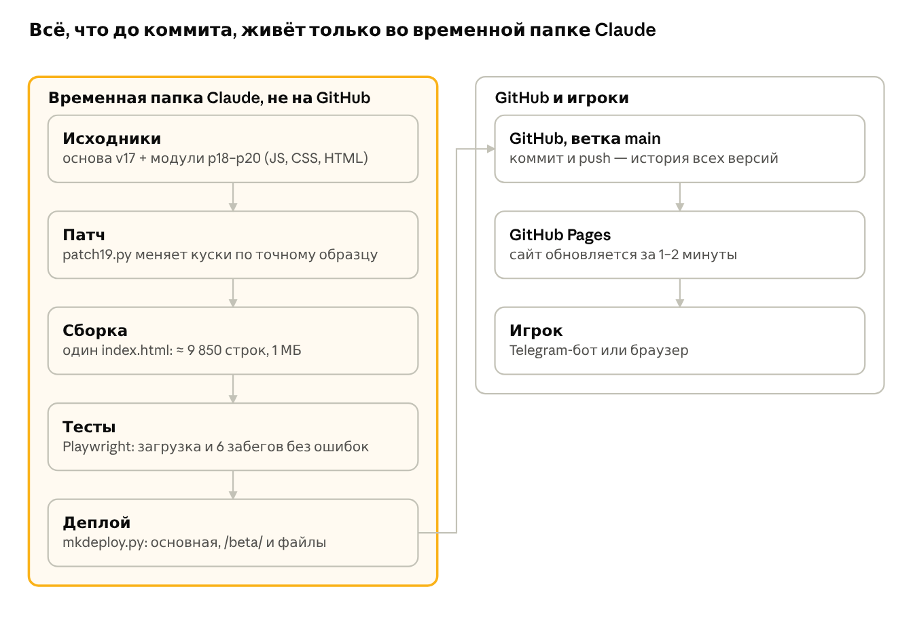

Если временная папка пропадёт, следующую версию придётся собирать из готового `index.html` вручную. Поэтому первый пункт раздела 26 — перенести исходники и тесты в репозиторий.

**Почему патчи.** В файле на 1 МБ легко заменить не то место. Скрипт меняет кусок, только если находит его ровно столько раз, сколько ожидается. Иначе сборка останавливается с ошибкой:

```python
def rep(old, new, cnt=1):
    n = h.count(old)        # сколько раз кусок встречается в файле
    assert n == cnt         # не столько, сколько ждали — стоп
    h = h.replace(old, new)
```

**Бета и основная — один исходник.** Разницу делает флажок `BETA`: он включён, если в адресе есть `/beta/`. В бете своё сохранение (ключ `wordrush-forest-v1-beta`), нет облака Telegram, есть Конструктор и редактор скинов.

Что это значит для тебя:

- Рецепты из раздела 16 работают, но перед моей следующей сборкой напиши, что меняла. Иначе сборка затрёт твои правки.
- Номера строк в разделе 15 устарели: файл вырос с 6 850 до 9 850 строк. Ищи по фразе из таблицы.
- Числа «на вкус» (скорость, туман, плотность декора) меняй в Конструкторе беты и присылай мне код `WR-TUNE`. Руками в коде их лучше не трогать.

## 21. Реверс-инжиниринг: как разбирать чужие игры

Чужую игру разбирают по поведению: играют, записывают, измеряют. Вскрывать файлы и вытаскивать чужие модели, текстуры и код нельзя: это нарушает лицензию и авторское право.

### Порядок разбора

1. **Один вопрос на разбор.** Например: «почему после проигрыша хочется ещё один забег?».
2. **Запись и секундомер.** Запиши 2–3 минуты игры с экрана и смотри покадрово. Считай: секунды до первого решения, паузу между событиями, время от проигрыша до нового забега.
3. **Схема MDA.** Правило (Mechanics) → что из него возникает в игре (Dynamics) → что чувствует игрок (Aesthetics). Пример для Subway Surfers: «3 полосы и препятствия» → «решение каждые 1–2 секунды» → «поток».
4. **Циклы.** Короткий: действие → награда → трата → снова действие. Длинный: чем игрок занят неделю.
5. **Под капот веб-игры — честно.** Chrome DevTools → Performance (сколько миллисекунд идёт кадр) и Network (что и сколько грузится). Расширение Spector.js показывает, из каких команд видеокарте собран один кадр WebGL: число вызовов отрисовки, текстуры, шейдеры.
6. **Слова самих авторов.** Доклады GDC, постмортемы, вики фанатов с точными цифрами.
7. **Вывод одной строкой:** какую причину берём. Форму, картинки и имена не берём.

### Механики, которые подходят Word Rush

| Образец | Механика | Как применить у нас | Зачем | Работы |
| --- | --- | --- | --- | --- |
| Subway Surfers | Word Hunt: буквы слова дня лежат на дороге | Буквы слова из твоих повторов разбросаны по тропе; собрала все — бонус | Тренирует написание без отдельного вопроса | мало |
| Left 4 Dead | «Режиссёр» (AI Director) чередует напряжение и отдых | После 2–3 ошибок подряд — спокойный участок без ловушек; серия верных — быстрее и теснее | Держит в «потоке», не даёт сдаться | средне |
| Hades | Проигрыш тоже двигает вперёд | За проигранный забег — хотя бы зачёт верных ответов по изученным словам | Меньше горечи — больше повторных забегов | мало |
| Vampire Survivors, рогалики | Выбор одного из трёх улучшений | Между этапами: магнит, +10% времени на ответ или щит — на один забег | Каждый забег немного другой | средне |
| Wordle | Одна задача в день для всех и результат цветными квадратами | «Забег дня» на одних словах и карточка результата для отправки в чат Telegram | Рост через друзей без рекламы | мало |
| Mario Kart | «Призрак» лучшего заезда | Дуэль с другом: его призрак бежит рядом на тех же словах, не одновременно | Соревнование без онлайн-сервера в реальном времени | много (нужно хранилище) |
| Duolingo | Заморозка серии, недельные лиги | «Заморозка» за конфеты; лига по верным ответам среди друзей | Серия не рвётся из-за одного дня | мало / много |
| Crypt of the NecroDancer | Действия в такт музыки | Препятствия и конфеты появляются на долях такта: музыка синтезируется, темп известен | Бег ощущается танцем | средне |
| Celeste | Assist Mode: облегчение без стыда | К «Времени на ответ» добавить скорость бега 80–100% | Играют и те, кому раннер труден | мало |

Чего не брать: сундуки на таймерах и платные «шансы» из Clash Royale и гача-игр. В учебной игре, в которую играют и дети, это тёмный паттерн, а не мотивация.

## 22. Оптимизация кода и алгоритмы на будущее

На iPhone игра идёт ровно. Слабые места другие: тяжёлая первая загрузка и код, который трудно менять. Ниже всё по порядку пользы.

### Загрузка

| Сейчас | Что сделать | Что даст |
| --- | --- | --- |
| До главного экрана качается ≈11 МБ за 18 запросов (мой замер). 6 моделей грузятся строго по очереди: `await` в цикле `loadAssets` | Качать модели параллельно (`Promise.all`) | Экран загрузки короче: запросы не ждут друг друга |
| Модели хранятся в `.js` как base64: +33% к размеру и лишняя распаковка `atob` | Обычные `.glb`, геометрия сжата meshopt или Draco, текстуры — KTX2 | Меньше трафика и памяти видеокарты |
| Декор kit18 (4,4 МБ) грузится целиком | Грузить декор только той главы, в которой играешь | Быстрый старт забега |
| Офлайн не работает | Кэш файлов в service worker | Второй запуск мгновенный и без сети |
| Версию в адресе (`?v=17`) дописываю вручную | Сборка сама дописывает к имени файла отпечаток содержимого | Телефон никогда не покажет старую картинку |
| Шрифты грузятся с Google Fonts | Положить шрифты в `a/fonts` | Интерфейс не прыгает, если Google медленный |

### Кадр

| Сейчас | Что сделать | Что даст |
| --- | --- | --- |
| В коде 63 вызова `new T.Vector3(`, часть стоит в покадровом коде (брелок создаёт векторы каждый кадр) | Создать векторы один раз и переиспользовать | Нет микрофризов от сборщика мусора |
| `dispose()` есть только в 5 местах | Освобождать геометрию и текстуры, когда пересобираются брелок, скин, карточка | Safari не выгружает игру из-за памяти |
| Ореолы, дымка и частицы — прозрачные слои друг на друге | Бюджет по `renderer.info` (вызовы отрисовки, треугольники). Telegram с Mini Apps 2.0 сообщает мощность устройства: на слабых — меньше слоёв | Ровные кадры на слабых Android |
| three.js r128 (2021 год) | Перейти на свежую версию, проверяя автопрогоном забегов | Исправления и новые возможности; чем позже, тем дороже переход |

### Код

1. Исходники — в репозиторий. Собирать обычным сборщиком (esbuild или Vite) из модулей `src/`, а не заменой строк (раздел 26).
2. Разделить по ролям: `data/` (слова, скины, этапы), `core/` (повторения, сохранение, экономика — без 3D), `render/`, `ui/`. Тогда повторения проверяются тестами без браузера.
3. Тесты в репозитории: модульные для повторений и экономики (Vitest) и мой прогон 6 забегов (Playwright) в GitHub Actions на каждый push. Сломанная версия не дойдёт до игроков.
4. Номер версии в сохранении (`S.ver`) и по функции перехода на каждую версию.
5. Одно «зерно» случайности на забег вместо 280 вызовов `Math.random()`. Забег с ошибкой можно будет повторить точь-в-точь.
6. Перехват ошибок у игроков: `window.onerror` и `unhandledrejection` отправляют короткий отчёт (версия, устройство, текст ошибки).

### Алгоритмы учёбы

**FSRS вместо одинаковых интервалов.** Сейчас интервалы у всех слов одни: `[0,1,3,7,14,30]` дней. Алгоритм FSRS (он есть в Anki) хранит у каждого слова стабильность S и сложность D. Стабильность — через сколько дней вероятность вспомнить упадёт до 90%. Вероятность вспомнить через t дней:

```math
R(t) = \left(1 + F\frac{t}{S}\right)^{C}, \quad F = \frac{19}{81},\ C = -0.5
```

Следующий повтор назначается, когда R падает до желаемой удержанности R\_d:

```math
I = \frac{S}{F}\left(R_d^{1/C} - 1\right)
```

Проверка: при R\_d = 0,9 скобка равна 0,9^(−2) − 1 = 0,2346 = F, значит I = S. Следующий повтор ровно через S дней — так стабильность и определена. По документации Anki, FSRS даёт ту же удержанность за меньшее число повторений.

**Half-life regression (Duolingo).** Вероятность вспомнить p = 2^(−Δ/h): Δ — дни с последнего повтора, h — «период полураспада» слова. Пример: h = 4 дня, через 4 дня p = 0,5. Модель учит h по ответам всех игроков, поэтому она нужна после релиза, когда игроков много.

**Правило 85%.** Обучение идёт быстрее всего, когда верных ответов около 85% (Wilson и соавторы, 2019). Игра может держать эту долю сама: выше — меньше времени на ответ и варианты похожее, ниже — наоборот.

**Неверные варианты из настоящих ошибок.** `misLog` уже записывает, что игрок выбрал вместо верного. Эти слова и надо чаще ставить неверными вариантами: они проверяют лучше случайных.

**Трудные слова отдельно.** Слово, проваленное 6–8 раз, не гонять по кругу, а показать иначе: пример, картинка-ассоциация, другой тип вопроса. В Anki такие слова помечаются как «пиявки».

## 23. Выпуск на платформы: где и как это делают другие

Из России, без иностранного номера и карты, реальны четыре площадки: Telegram, Яндекс Игры, VK и RuStore. Лучший следующий шаг — Яндекс Игры: там больше всего бесплатных игроков и выплаты физлицу.

| Площадка | Что нужно сделать | Деньги | Для тебя |
| --- | --- | --- | --- |
| [Telegram Mini App](https://core.telegram.org/bots/payments-stars) (уже есть) | Для продаж — только Telegram Stars; бот отвечает на /paysupport и делает возвраты. Полезное из [Mini Apps 2.0](https://telegram.org/blog/fullscreen-miniapps-and-more): полный экран, ярлык на домашний экран, мощность устройства, подписки | Stars за скины и конфеты. Реклама [AdsGram](https://adsgram.ai/blog/adsgram/adsgram-and-hilltopads-for-publishers-formats-requirements-and-payouts): за награду, между экранами, задания; выплата в USD₮ на TON от 100 (или от 10 раз в месяц) | Работает уже сейчас. Вывод криптовалюты из России — вопрос для юриста и налоговой до монетизации |
| [Яндекс Игры](https://yandex.ru/dev/games/doc/ru/concepts/requirements) | SDK: `LoadingAPI.ready()`, `GameplayAPI.start/stop`; все файлы ≤100 МБ; вход только Яндекс ID и игра без входа; реклама только через SDK и в паузах; уникальное название; права на все материалы; модерация 3–5 рабочих дней | Реклама и покупки через SDK. [Выплаты](https://yandex.ru/dev/games/doc/ru/payments) физлицу (НДФЛ удерживает Яндекс), самозанятому (6%) или ИП; от 3000 ₽, раз в месяц | Главный кандидат |
| [VK Игры](https://dev.vk.ru/en/games/getting-started) (ВКонтакте и ОК) | VK Bridge, `VKWebAppInit` в первые 30 с; бесплатный хостинг; заявка в каталог | Покупки и реклама | Вторая площадка |
| [VK Play](https://vc.ru/dev/2276618-vk-play-dlya-razrabotchikov-igr) | Регистрация бесплатная, физлицам можно; модерация около 2 дней; новому проекту — около 350 тыс. показов | Платная игра или покупки | Скорее для скачиваемых игр |
| [RuStore](https://www.rustore.ru/help/developers/developer-account/registration-developer) (Android) | Обернуть сайт в APK (Capacitor). Физлицо: подписать электронную форму и пройти удалённую проверку личности | [Монетизация для самозанятых](https://kod.ru/6985), вывод от 5000 ₽ (данные 2023 года) | Android без Google |
| [Google Play](https://support.google.com/googleplay/android-developer/answer/14151465?hl=en) | Новый личный аккаунт: закрытый тест, 12 тестеров 14 дней подряд | Платная регистрация, выплаты через зарубежные системы | Сейчас не для тебя |
| [CrazyGames](https://docs.crazygames.com/requirements/technical/) | Первая загрузка ≤50 МБ (≤20 МБ для главной на телефоне), всего ≤250 МБ, ≤1500 файлов, до игры ≤20 с; SDK для полного запуска | Реклама после полного запуска | Наши 11 МБ проходят. Нужен английский интерфейс; выплаты в Россию проверь до запуска |

### Как это делают другие

1. **Одна сборка, слой-адаптер.** Один объект `PLATFORM` с функциями `init`, `ready`, `save`, `load`, `showAd`, `buy`, `share` и по реализации на Telegram, Яндекс, VK и обычный сайт. Игра не знает, где запущена.
2. **Сначала площадка с бесплатным трафиком.** [Опыт судоку «Цифры»](https://wnhub.io/ru/news/stores-and-publishing/item-40292) (2023): в первый месяц около 5000 игроков на Яндексе; бесплатных игроков там в разы больше, чем на VK Play, а реклама принесла в сотни раз больше. Платный игрок через Яндекс Директ стоил 4–12 ₽.
3. **Русский, английский, турецкий сразу.** Без английского игра не попадёт в подборки Яндекса (тот же источник).
4. **Обе ориентации экрана.** Больше игроков и рекламных показов.
5. **Метрики до рекламы.** Удержание на 1-й и 7-й день, длина сессии, на каком экране уходят. Сначала чинят их, потом покупают игроков.
6. **Страница игры.** Иконка, обложка (не скриншот), 5 скриншотов и видео, где игры не меньше 70% (правило Яндекса), описание и «как играть».

## 24. Чего не хватает для релиза

Играть уже интересно. Выходить на площадки нельзя, пока не закрыты 6 блокеров: чужие картинки, неверные факты, занятое название, исходники вне репозитория, ошибка «быстрого ответа» и нет политики конфиденциальности. Отмечай сделанное галочкой.

### Без этого не выходить

- [ ] Свои картинки на 60 карточках коллекции и в принтах скинов. Сейчас там чужие персонажи и логотипы: Minecraft, Undertale, Five Nights at Freddy's, Zelda, Pokémon, паук, Гринч, Веном, красные облака. Площадки требуют прав на все материалы (Яндекс, п. 3.5).
- [ ] Проверить все 60 фактов по первоисточникам: как минимум два неверны (раздел 25).
- [ ] Своё название или отличительная приставка. «Word Rush» уже занято несколькими играми в App Store (например, [Word Rush — Word Game](https://apps.apple.com/us/app/-/id6478608716), [Word Rush: Race with friends](https://apps.apple.com/app/id1471499627)), а Яндекс требует уникального имени.
- [ ] Исходники, инструменты и тесты — в репозитории (раздел 26).
- [ ] Исправить «быстрый ответ без движения» (раздел 25).
- [ ] Политика конфиденциальности и контакт поддержки внутри игры. Telegram передаёт мини-приложению ID, имя, фото и язык игрока, а за данные отвечает разработчик ([условия Mini Apps](https://telegram.org/tos/mini-apps)). Для продаж за Stars нужна команда /paysupport.

### В первый месяц

- [ ] Отчёты об ошибках и простая аналитика: начало и конец забега, точность, на какой карточке обучения игрок ушёл.
- [ ] Облачное сохранение: слияние по словам и предупреждение, если запись не удалась.
- [ ] Проверка на 2–3 слабых Android и в Telegram для компьютера.
- [ ] Английский интерфейс: нужен Яндексу и зарубежным площадкам.
- [ ] Плейтест: 5–10 человек уровня B1, не знакомых с игрой. Смотреть молча и записывать, где они застряли.
- [ ] Модель денег: что продаётся (скины, конфеты), реклама только по желанию и за награду. Деньги не покупают знание слов.
- [ ] Страница игры: иконка, обложка, 5 скриншотов, видео 20–30 с, описание.

### Потом

- [ ] Больше слов. Сейчас 286: 126 основных и 160 слов уровней — это на несколько недель игры.
- [ ] Примеры и переводы проверяет преподаватель или носитель языка.
- [ ] Офлайн и сжатые модели (раздел 22).
- [ ] Выключатель пугалки в туннеле в «Игровых элементах».
- [ ] Ответ на открытый вопрос из GAME\_RULES: тыквы в главе 1 оставить или убрать.

## 25. Ошибки и недочёты, которые я вижу в игре

Самая важная ошибка — в учёбе: если не двигаться, игра считает ответ быстрым и повышает слово. Всё проверено по коду v20.4, от серьёзного к мелкому.

| Что | Чем плохо | Как исправить |
| --- | --- | --- |
| **Не двигаться = «быстрый верный ответ».** Когда появляется вопрос, `q.lastMove = q.spawn`. Если верный волк уже на твоей полосе и ты стоишь, разница 0 ≤ 62% окна → `firstFast = true` | Слово уходит в следующую коробку без вспоминания. Если не шевелиться, так случается в 1 из 3 вопросов | Не двигалась — ответ верный, но не быстрый: слово остаётся в своей коробке. Место в коде: `function record`, `resolveRun` |
| **Угадывание.** Вариантов три, случайно попасть — 33%; одно удачное попадание поднимает слово | В «Золото» попадают невыученные слова | Повышать после двух верных ответов в разных забегах или в разных типах вопроса |
| **Неверные факты в коллекции.** «Создатель Hollow Knight был единственным разработчиком» — игру сделала студия Team Cherry: Уильям Пеллен, Ари Гибсон, потом Дэвид Кази и композитор Крис Ларкин ([Game Informer](https://www.gameinformer.com/2018/10/16/the-making-of-hollow-knight)). «Эндермен добавлен случайно, это баг» — его ввели намеренно в Beta 1.8, по мотивам Slender Man ([Minecraft Wiki](https://minecraft-archive.fandom.com/wiki/Enderman)) | Учебная игра учит неправде | Проверить все 60, у каждого факта хранить ссылку на источник |
| **Чужие персонажи** на карточках и принтах скинов | Блокер для площадок и продаж | Свои арты. Факт об игре можно оставить, картинка нужна своя |
| **Облачное сохранение «целиком, кто свежее».** Сравнивается `savedAt` по часам устройства (`tgCloudInit`) | Сыграла без сети на одном устройстве, потом на другом — часть прогресса пропадёт. Неверные часы ломают выбор | Сливать по словам: у каждого слова брать запись с более поздним повтором |
| **Тихие ошибки сохранения.** `save()` глушит ошибку записи пустым `catch` | Игрок не узнает, что прогресс не записался | Плашка «Не удалось сохранить» и повтор записи |
| **Тяжёлая первая загрузка:** ≈11 МБ до главного экрана, модели по очереди | На мобильном интернете долгий экран загрузки, часть игроков уйдёт | Раздел 22, «Загрузка» |
| **Нет отчётов об ошибках** у игроков | Игра упала у человека — мы не узнаем | `window.onerror` → короткий отчёт |
| **Только русский интерфейс** | Нельзя в подборки Яндекса и на зарубежные порталы | Все надписи — в один словарь, потом перевод |
| **Пугалку в туннеле нельзя выключить:** вампир бросается в камеру со вспышкой | Детям и пугливым неприятно; Яндекс требует материалов для всех возрастов | Выключатель в «Игровых элементах» |

## 26. Что меня беспокоит в коде

Главный риск не в игре, а в том, где лежат её исходники. Остальное делает каждую следующую правку дороже предыдущей.

1. **Исходники живут только в моей временной папке.** В репозитории лежит собранный `index.html`. То, из чего он собирается, — патчи `patch18.py` и `patch19.py`, модули `p18_*.js`, `p19*.js`, `p20.js`, куски HTML главной и магазина, Python-скрипты для атласов, скинов и моделей, автотесты — лежит в облачном контейнере, который удаляется после простоя. Пропадёт он — каждую правку придётся делать вручную в файле на 9 850 строк. Лечение: папки `src/` и `tools/` в репозитории. Сделаю по твоему «ок».
2. **Патчи поверх патчей.** v18 оборачивает v17 (`loseHeart` вызывает `loseHeart0`), v19 и v20 правят уже правленное. Чтобы понять, что делает функция, надо пройти 3–4 слоя. Любой сдвиг в базовом файле ломает десятки замен.
3. **Один файл и общее состояние.** 1,07 МБ кода, и переменные `S`, `G`, `TUNE`, `hero` видны отовсюду. Правка в одном месте неожиданно ломает другое. Поэтому каждую версию я проверяю полным прогоном забегов.
4. **42 пустых `catch`.** Часть — нормальная защита (старые версии Telegram), часть прячет настоящие сбои. Нужно хотя бы писать их в журнал.
5. **Память.** Векторы создаются в покадровом коде, ресурсы почти не освобождаются. С новыми главами и скинами Safari может начать выгружать игру.
6. **Старая three.js r128.** Примеры из интернета пишутся под свежие версии (случай с `color.set` из раздела 17). Чем дольше ждём, тем больше переписывать.
7. **Модели как текст.** 17 МБ base64 в `models/`, которые браузер сначала читает как код, потом переводит в двоичный вид.
8. **Сохранение без версии.** Переходы старых сохранений разбросаны по коду (`migrateRelics`). При смене формата легко сломать прогресс игроков.
9. **Всё доверяет телефону.** Конфеты, прогресс и время (`Date.now()` + смещение) считает клиент. Для одиночной игры это нормально. Для таблиц лидеров и продаж нужен сервер, который проверяет подпись `initData` от Telegram.

## 27. Где, по-моему, автор не прав

Коротко: ты вкладываешься в вид больше, чем в учёбу и релиз, и несколько твоих решений работают против цели игры — выучить слова. Это мнение, а не правило: решаешь ты.

1. **Полировка раньше основы.** 13 ноября вышло 4 версии, три из них — про плёнку карточки и брелок (v20.2–v20.4). Блокеры из раздела 24 при этом не тронуты. Новый игрок решает за первые минуты, и решает по загрузке и смыслу, а не по застёжке. **Предлагаю:** заморозить визуал, пока не закрыт чек-лист.
2. **Предложения выключены по умолчанию.** Уровень B1–B2 — это употребление: сочетания и контекст. Перевод en↔ru тренирует только узнавание. **Предлагаю:** включать предложения сами, когда слово дошло до Серебра I, без переключателя.
3. **Проигранный забег не засчитывает ничего** (v19). Верный ответ — уже случившееся вспоминание. Выкидывая его, игра теряет данные и наказывает за ловкость: врезалась в камень — выученное не в счёт. **Предлагаю:** новые слова — только за финиш, как сейчас, а верные ответы по уже изученным словам засчитывать всегда.
4. **−30% конфет за удар о препятствие.** Ошибка в слове стоит сердце, а промах по камню — треть заработка. Штраф за ловкость больнее штрафа за незнание, хотя в учебной игре должно быть наоборот. **Предлагаю:** 10–15% в обычном режиме, 30% — в ХАРДе.
5. **«Сразу в основную».** Пока единственный игрок — ты, это удобно. С живыми игроками каждая правка без беты рискует чужим прогрессом. **Предлагаю:** после релиза — только через бету, как записано в GAME\_RULES.
6. **Решения до проверки.** С 3 по 8 ноября — 5 откатов ↩️ (v18.1–v19). **Предлагаю:** новое включать переключателем в бете и решать после 2–3 дней игры, а не по первому впечатлению.
7. **Тестирует один человек.** Ты знаешь все слова и все механики, поэтому не видишь, где застрянет новичок. **Предлагаю:** 5–10 чужих игроков уровня B1 и хотя бы один слабый Android до релиза.
8. **Чужие франшизы в коллекции и принтах.** Героиня и миры уже свои, а самая «собирательная» часть игры держится на чужих персонажах. **Предлагаю:** своя коллекция — например, факты про слова и их происхождение с твоими артами. Это и легально, и ближе к учёбе.

## 28. Словарь терминов

| Термин | Что это простыми словами | Раздел |
| --- | --- | --- |
| Атлас | Одна большая картинка, на которой собраны много маленьких, + таблица, где какая | 6 |
| Бета | Копия игры по адресу /beta/ со своим сохранением: там новое проверяют до основной игры | 20 |
| Библиотека | Чужой готовый код, который подключают целиком (three.js) | 4 |
| Билборд | Плоская картинка в 3D, всегда повёрнутая к камере | 6 |
| Интервальные повторения | Повторять слово всё реже, пока отвечаешь верно и быстро | 8 |
| Камера | Точка, из которой смотрит игрок | 4 |
| Коммит | Сохранённая версия файлов в истории GitHub | 13, 14 |
| Конечный автомат | Игра всегда в одной «фазе», у каждой свои правила (`G.phase`) | 5 |
| Консоль | Окно в Chrome (F12), где видны ошибки и можно вводить команды | 14, 17 |
| Конструктор (TUNE) | Панель ⚙ в бете: ползунки меняют числа «на вкус» вживую, «Экспорт» даёт код WR-TUNE | 19 |
| Кэш | Копия файла в памяти телефона; из-за неё иногда видна старая версия | 13 |
| Материал | «Краска» предмета: цвет, картинка, как он реагирует на свет | 4 |
| Объект `{ }` | Набор полей «имя: значение», например одно слово или один скин | 3 |
| Палитра | Набор цветов одного мира: небо, туман, свет, трава (`PALS`) | 6 |
| Патч | Скрипт, который заменяет в файле точный кусок кода на новый; из патчей собирается index.html | 20 |
| Переменная | Имя, под которым хранится значение (`const LANES = ...`) | 3 |
| Рендерер | Часть three.js, которая превращает сцену в картинку на экране | 4 |
| Репозиторий | Папка проекта на GitHub со всей историей изменений | 13 |
| Ретаргет | Перенос анимации с одного скелета на другой | 7 |
| Риггинг / скиннинг | Постановка скелета / привязка «кожи» к костям | 7 |
| Сдвиг глубины | Предмет рисуется на своём месте, но при проверке «что перед чем» считается чуть ближе к камере (брелок не проваливается в штаны) | 19 |
| Сетка (Mesh) | Любой видимый 3D-предмет: форма + материал | 4 |
| Скелет / кости | Невидимый каркас внутри персонажа, который двигает модель | 7 |
| Список (массив) `[ ]` | Перечень чего-то через запятую: слова, цены, цвета | 3 |
| Сцена | Всё, что есть в 3D-мире | 4 |
| Текстура | Картинка, натянутая на 3D-форму по «выкройке» | 7 |
| Функция | Именованное действие в коде (`function startDuel(){ ... }`) | 3 |
| Шейдер | Маленькая программа для видеокарты: изгиб мира, контуры | 6, 7 |
| BPM | Ударов в минуту, темп музыки | 11 |
| CloudStorage | Облачное хранилище Telegram для Mini App | 13 |
| dt | Сколько секунд прошло с прошлого кадра | 5 |
| FBX / GLB | Форматы 3D-файлов: FBX — для программ, GLB — компактный для веба | 4, 7 |
| FSRS | Алгоритм повторений: у каждого слова своя стабильность памяти и свой интервал | 22 |
| GitHub Pages | Бесплатный хостинг сайта прямо из репозитория | 13 |
| IndexedDB / localStorage | Память браузера на устройстве: для своего трека / для сохранения | 11, 13 |
| Instancing | Один предмет рисуется много раз за одну команду видеокарте | 6 |
| Mini App | Сайт, который открывается внутри Telegram-бота | 13 |
| Push | Отправить коммиты с компьютера на GitHub | 14 |
| SDK | Набор функций площадки (Яндекс, VK), который игра обязана подключить: загрузка, реклама, покупки | 23 |
| Service worker | Фоновый скрипт сайта: хранит файлы, чтобы игра открывалась без сети | 22 |
| Telegram Stars | Валюта Telegram: только за неё можно продавать цифровые товары в мини-приложении | 23 |
| Toon-свет | Мультяшное освещение ступенями вместо плавного перехода | 7 |
| UV | Координаты точки на картинке-текстуре | 6, 7 |
| Web Audio API | Встроенный в браузер синтезатор звука | 11 |

## 29. Источники

### Документация и учебники

- [three.js — Creating a scene](https://threejs.org/manual/en/creating-a-scene): первый урок про сцену, камеру и рендерер. Помни, что в игре стоит старая версия r128, и часть команд из свежей документации может работать иначе.
- [MDN — Learn web development](https://developer.mozilla.org/en-US/docs/Learn): курс HTML, CSS и JavaScript с нуля.
- [MDN — Web Audio API](https://developer.mozilla.org/en-US/docs/Web/API/Web_Audio_API): как браузер синтезирует звук.
- [Telegram Mini Apps](https://core.telegram.org/bots/webapps): Mini App, кнопка меню, лимиты CloudStorage (1024 записи, до 4096 символов в записи).
- [GitHub Pages — источник публикации](https://docs.github.com/en/pages/getting-started-with-github-pages/configuring-a-publishing-source-for-your-github-pages-site): как публиковать сайт из ветки.
- [github.dev](https://docs.github.com/en/codespaces/the-githubdev-web-based-editor): редактор в браузере по клавише «.».
- [Mixamo](https://www.mixamo.com/) и [вопросы про Mixamo от Adobe](https://helpx.adobe.com/en/creative-cloud/faq/mixamo-faq.html): автоматический скелет и библиотека движений.
- [World bending effect](https://notslot.com/tutorials/2020/04/world-bending-effect): учебник по изогнутому миру.
- [GuiltyGearXrd's Art Style: The X Factor Between 2D and 3D (GDC)](https://gdcvault.com/play/1022031/GuiltyGearXrd-s-Art-Style-The): как 3D делают похожим на рисунок.
- [Leitner system](https://en.wikipedia.org/wiki/Leitner_system) и [Spaced repetition](https://en.wikipedia.org/wiki/Spaced_repetition): коробки и интервальные повторения.

### Игры-образцы

- Раннер: [Subway Surfers](https://en.wikipedia.org/wiki/Subway_Surfers), [Temple Run](https://en.wikipedia.org/wiki/Temple_Run), [Time Tangle — Adventure Time](https://toucharcade.com/games/time-tangle-adventure-time).
- Учёба и слова: [The Typing of the Dead](https://en.wikipedia.org/wiki/The_Typing_of_the_Dead), [Duolingo](https://en.wikipedia.org/wiki/Duolingo).
- Сложность и бои: [Dark Souls](<https://en.wikipedia.org/wiki/Dark_Souls_(video_game)>), [Cuphead](https://en.wikipedia.org/wiki/Cuphead), [Sekiro: Shadows Die Twice](https://en.wikipedia.org/wiki/Sekiro:_Shadows_Die_Twice), [Quick time event](https://en.wikipedia.org/wiki/Quick_time_event), [The Legend of Zelda: A Link to the Past](https://en.wikipedia.org/wiki/The_Legend_of_Zelda:_A_Link_to_the_Past).
- Визуал: [Paper Mario](https://en.wikipedia.org/wiki/Paper_Mario), [Don't Starve](https://en.wikipedia.org/wiki/Don%27t_Starve), [Octopath Traveler](https://en.wikipedia.org/wiki/Octopath_Traveler), [Animal Crossing: New Horizons](https://en.wikipedia.org/wiki/Animal_Crossing:_New_Horizons).
- Коллекция, музыка, обучение: [Little Nightmares](https://en.wikipedia.org/wiki/Little_Nightmares), [Audiosurf](https://en.wikipedia.org/wiki/Audiosurf), [Pokémon (мультсериал)](<https://en.wikipedia.org/wiki/Pok%C3%A9mon_(TV_series)>).

### Инструменты

- [GitHub Desktop](https://desktop.github.com/), [VS Code](https://code.visualstudio.com/), [Squoosh](https://squoosh.app/) (перевод картинок в WebP).

### Для части 4

- Площадки: [Telegram — платежи за цифровые товары (Stars)](https://core.telegram.org/bots/payments-stars), [Mini Apps 2.0](https://telegram.org/blog/fullscreen-miniapps-and-more), [Условия Mini Apps](https://telegram.org/tos/mini-apps), [AdsGram для паблишеров](https://adsgram.ai/blog/adsgram/adsgram-and-hilltopads-for-publishers-formats-requirements-and-payouts), [Яндекс Игры — требования](https://yandex.ru/dev/games/doc/ru/concepts/requirements), [Яндекс Игры — выплаты](https://yandex.ru/dev/games/doc/ru/payments), [VK Игры — начало работы](https://dev.vk.ru/en/games/getting-started), [VK Play для разработчиков](https://vc.ru/dev/2276618-vk-play-dlya-razrabotchikov-igr), [RuStore — регистрация](https://www.rustore.ru/help/developers/developer-account/registration-developer), [RuStore — монетизация для самозанятых (2023)](https://kod.ru/6985), [Google Play — тестирование новых аккаунтов](https://support.google.com/googleplay/android-developer/answer/14151465?hl=en), [CrazyGames — технические требования](https://docs.crazygames.com/requirements/technical/), [Опыт судоку на Яндекс Играх и VK Play](https://wnhub.io/ru/news/stores-and-publishing/item-40292).
- Алгоритмы: [FSRS в Anki](https://docs.ankiweb.net/faqs/what-spaced-repetition-algorithm), [FSRS в 100 строках](https://borretti.me/article/implementing-fsrs-in-100-lines), [Half-life regression (Duolingo)](https://www.github.com/duolingo/halflife-regression), [The Eighty Five Percent Rule for optimal learning](https://ideas.repec.org/a/nat/natcom/v10y2019i1d10.1038_s41467-019-12552-4.html).
- Проверка фактов и названия: [The Making of Hollow Knight (Game Informer)](https://www.gameinformer.com/2018/10/16/the-making-of-hollow-knight), [Enderman (Minecraft Wiki)](https://minecraft-archive.fandom.com/wiki/Enderman), [Word Rush — Word Game](https://apps.apple.com/us/app/-/id6478608716), [Word Rush: Race with friends](https://apps.apple.com/app/id1471499627).

### Твой проект

- Игра: https://sugero205.github.io/WordRushEnglishBro\_bot/ · бот: @WordRushEnglishBro\_bot · код: репозиторий `sugero205/WordRushEnglishBro_bot`, в нём README.md с настройкой бота.
- Скриншоты в пособии сняты с версии v17.4 (2 ноября 2026), номера строк — по той же версии.
- Часть 4 и пометки «Сейчас» — по коду v20.4 (14 ноября 2026).
